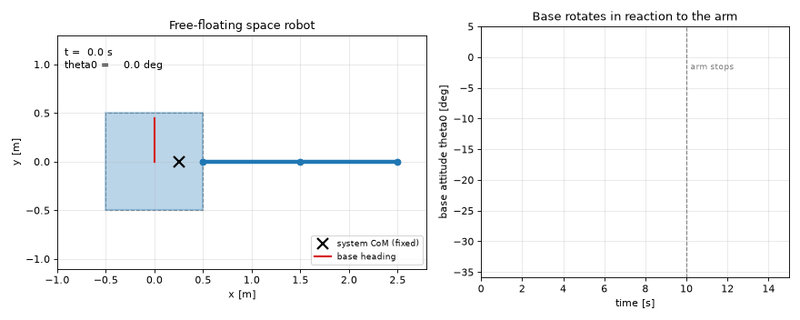
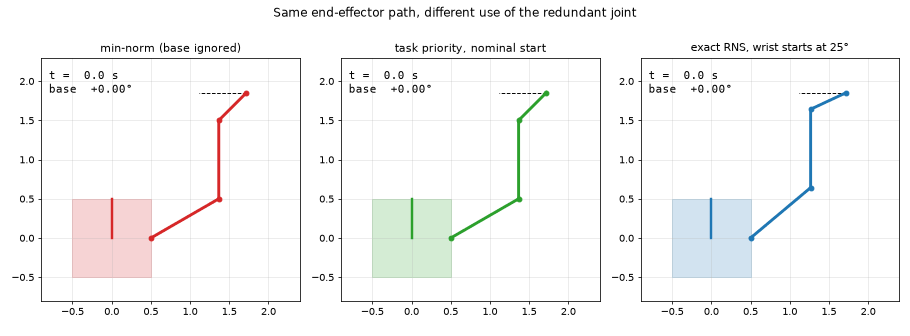
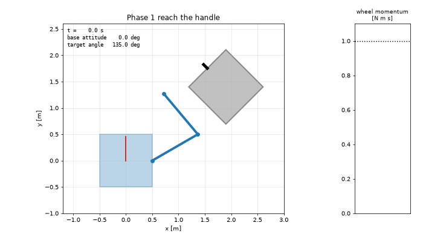
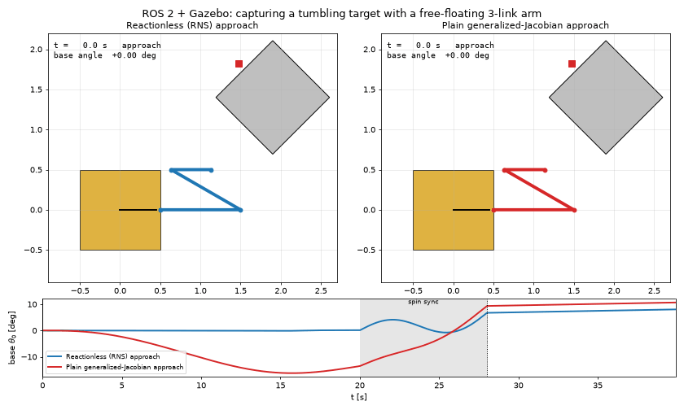
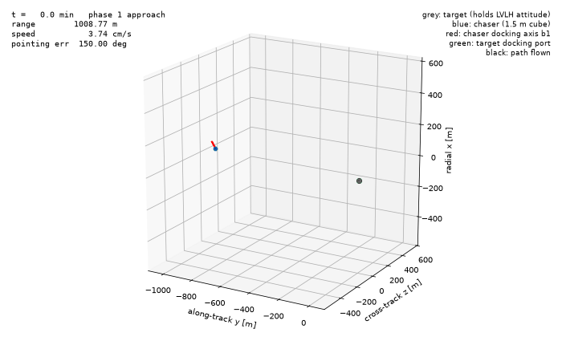
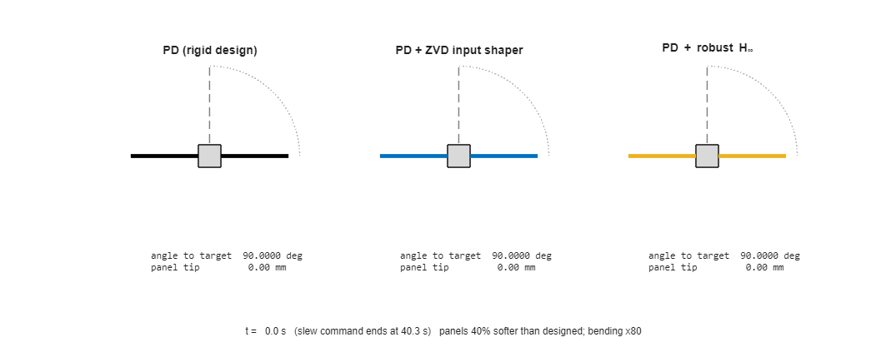
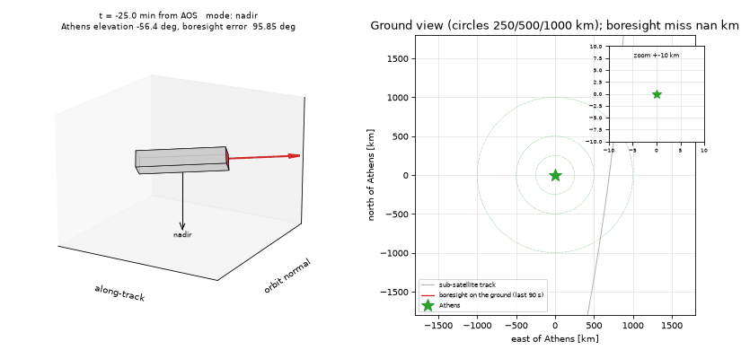
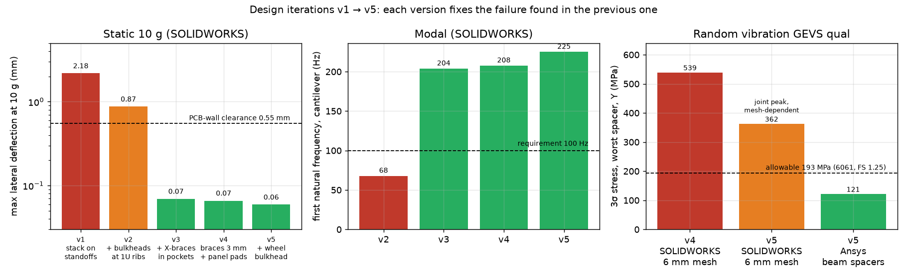

# Space Robotics Simulations

Small, self-contained simulations of space robotic systems and spacecraft, each checked against an
independent model (conservation laws, closed-form solutions, a second simulator or hand calculations).
Tools: Python (NumPy/SciPy/SymPy), MATLAB/Simulink, ROS 2 + Gazebo, SOLIDWORKS Simulation and Ansys.

The projects are grouped by theme; the folder numbers give the order in which they were built.

| Theme | Projects |
|---|---|
| [A. Free-floating space manipulators](#a-free-floating-space-manipulators) | 1, 1b, 3, 5 |
| [B. Rendezvous and proximity operations](#b-rendezvous-and-proximity-operations) | 2 |
| [C. Spacecraft dynamics, control and structures](#c-spacecraft-dynamics-control-and-structures) | 4, 6, 7 |

## A. Free-floating space manipulators

One planar satellite-plus-arm robot, developed step by step: its dynamics, moving the arm without
disturbing the base, capturing a tumbling target, and the same robot in a physics engine.
Relevant to planning and control of space robots for assembly, contact dynamics and debris removal.

- **Project 1 – `project1_free_floating/`**: planar free-floating space manipulator
  (a satellite base carrying a 2-link robotic arm, no external forces).
  Shows how arm motion disturbs the base attitude and position, and verifies
  conservation of linear and angular momentum. The hand-derived Lagrange equations are
  cross-checked against an independent **Simscape Multibody** model (agreement 1e-10°).

  

- **Project 1b – `project1b_reaction_null_space/`**: extension of project 1, a third arm link is used to move
  the end effector **without rotating the base** (Reaction Null Space, as flown on
  ETS-VII). Exact, damped and minimum-norm control are compared at velocity and torque level,
  RNS singularities are mapped, and a sweep shows that the starting arm configuration decides
  whether zero-reaction motion is possible. The controllers are also run on a **Simscape
  Multibody** plant: the base attitude matches the Python prediction to 1e-6°.

  

- **Project 3 – `project3_debris_capture/`**: capture of a tumbling piece of debris by the
  free-floating robot of project 1: generalized Jacobian and dynamic
  singularities, reaching a moving handle, compliant and rigid grasp contact,
  reaction-wheel detumbling, and a 200-mission Monte Carlo over the unknown
  debris properties.

  

- **Project 5 – `project5_ros2_gazebo/`** (ROS 2 Jazzy + Gazebo Harmonic): the free-floating robots of
  projects 1/1b in a zero-g Gazebo world with `ros2_control`, validated against the Python
  models; a Reaction Null Space controller node; and reach + capture of project 3's tumbling
  target with the reactionless arm, including momentum checks through the capture.

  

## B. Rendezvous and proximity operations

- **Project 2 – `project2_rendezvous/`**: autonomous rendezvous and docking in low Earth orbit.
  Clohessy–Wiltshire relative motion (validated against the nonlinear two-body
  problem), LQR translation control, Euler-parameter attitude control with a
  Lyapunov tracking law, a Kalman filter for navigation, a 1 400-mission
  Monte Carlo robustness study and a Simulink cross-check of the attitude loop.

  

## C. Spacecraft dynamics, control and structures

- **Project 4 – `project4_flexible_spacecraft/`** (MATLAB): a spacecraft slewing with flexible solar
  panels whose stiffness is uncertain: hub + cantilever-mode model checked against finite
  elements, rigid PD, input shaping (ZV/ZVD/EI), nominal H∞, μ-synthesis and a structured robust
  H∞ controller, a 300-spacecraft Monte Carlo and a Simulink cross-check.

  

- **Project 6 – `project6_cubesat_adcs/`**: complete attitude determination and control for a 3U CubeSat in a
  500 km sun-synchronous orbit: IGRF-14 field, Sun/eclipse and disturbance torques; B-dot
  detumbling with 1 Hz flight software; TRIAD and a multiplicative EKF checked for consistency
  (NEES); reaction-wheel pointing with magnetic momentum unloading in a full closed loop;
  tracking of a ground target (Athens); 48-run Monte Carlo pointing budget.

  

- **Project 7 – `project7_cubesat_fea/`** (SOLIDWORKS Simulation + Ansys MAPDL): structural design of the same
  3U CubeSat against launch loads: five scripted design iterations (C# API), 10 g, modal, buckling and
  GEVS random vibration, cross-checked with an independently generated shell/beam/mass Ansys model
  and hand calculations (Miles' equation within 3 %); NASA-STD-5020A bolted-joint check. All margins
  positive; the bolted joints size the structure.

  

## Setup

```bash
py -3.14 -m venv .venv
.venv\Scripts\activate
pip install -r requirements.txt
```
