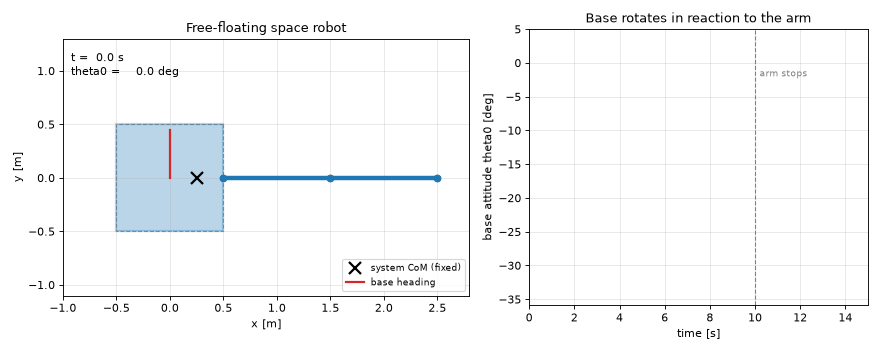
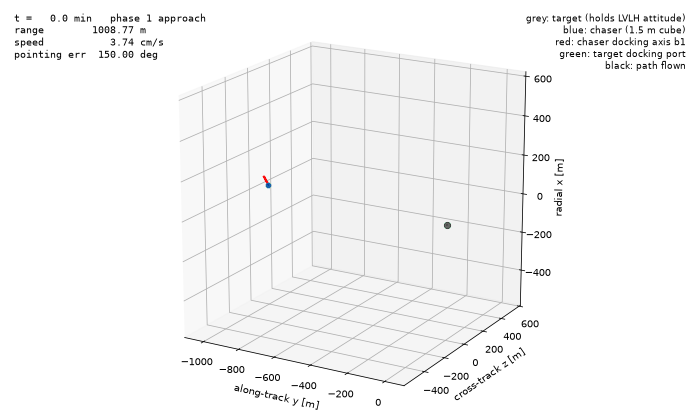
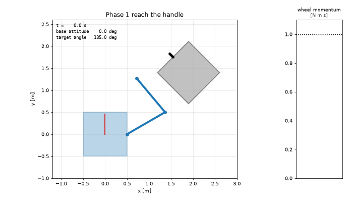

# Space Robotics Simulations

Small, self-contained Python simulations of space robotic systems.

## Projects

1. **`project1_free_floating/`** – planar free-floating space manipulator
   (a satellite base carrying a 2-link robotic arm, no external forces).
   Shows how arm motion disturbs the base attitude and position, and verifies
   conservation of linear and angular momentum.

   

2. **`project2_rendezvous/`** – autonomous rendezvous and docking in low Earth orbit.
   Clohessy–Wiltshire relative motion (validated against the nonlinear two-body
   problem), LQR translation control, Euler-parameter attitude control with a
   Lyapunov tracking law, a Kalman filter for navigation, and a 1 400-mission
   Monte Carlo robustness study.

   

3. **`project3_debris_capture/`** – capture of a tumbling piece of debris by the
   free-floating robot of project 1: generalized Jacobian and dynamic
   singularities, reaching a moving handle, compliant and rigid grasp contact,
   reaction-wheel detumbling, and a 200-mission Monte Carlo over the unknown
   debris properties.

   

4. **`project4_flexible_spacecraft/`** (MATLAB) – a spacecraft slewing with flexible solar
   panels whose stiffness is uncertain: hub + cantilever-mode model checked against finite
   elements, rigid PD, input shaping (ZV/ZVD/EI), nominal H∞, μ-synthesis and a structured robust
   H∞ controller, a 300-spacecraft Monte Carlo and a Simulink cross-check.

   

## Setup

```bash
py -3.14 -m venv .venv
.venv\Scripts\activate
pip install -r requirements.txt
```
