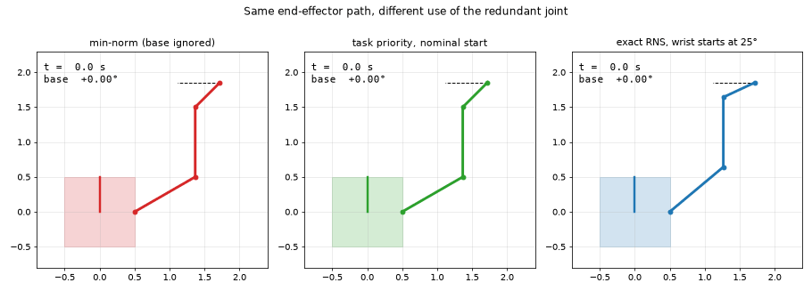
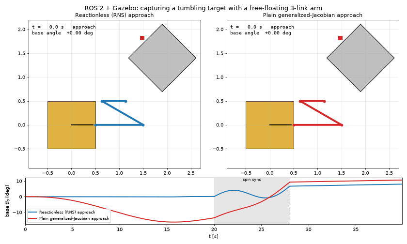
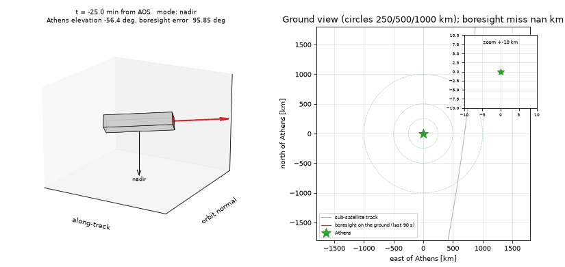

# Space Robotics Simulations

Small, self-contained Python simulations of space robotic systems.

## Projects

1. **`project1_free_floating/`** – planar free-floating space manipulator
   (a satellite base carrying a 2-link robotic arm, no external forces).
   Shows how arm motion disturbs the base attitude and position, and verifies
   conservation of linear and angular momentum.

   

   **`project1b_reaction_null_space/`** – extension: a third arm link is used to move
   the end effector **without rotating the base** (Reaction Null Space, as flown on
   ETS-VII). Exact, damped and minimum-norm control are compared at velocity and torque level,
   RNS singularities are mapped, and a sweep shows that the starting arm configuration decides
   whether zero-reaction motion is possible.

   

2. **`project2_rendezvous/`** – autonomous rendezvous and docking in low Earth orbit.
   Clohessy–Wiltshire relative motion (validated against the nonlinear two-body
   problem), LQR translation control, Euler-parameter attitude control with a
   Lyapunov tracking law, a Kalman filter for navigation, and a 1 400-mission
   Monte Carlo robustness study.

   

3. **`project3_debris_capture/`** – capture of a tumbling piece of debris by the
   free-floating robot of project 1: generalized Jacobian and dynamic
   singularities, reaching a moving handle, compliant and rigid grasp contact,
   reaction-wheel detumbling, and a 200-mission Monte Carlo over the unknown
   debris properties.

   

4. **`project4_flexible_spacecraft/`** (MATLAB) – a spacecraft slewing with flexible solar
   panels whose stiffness is uncertain: hub + cantilever-mode model checked against finite
   elements, rigid PD, input shaping (ZV/ZVD/EI), nominal H∞, μ-synthesis and a structured robust
   H∞ controller, a 300-spacecraft Monte Carlo and a Simulink cross-check.

   

5. **`project5_ros2_gazebo/`** (ROS 2 Jazzy + Gazebo Harmonic) – the free-floating robots of
   projects 1/1b in a zero-g Gazebo world with `ros2_control`, validated against the Python
   models; a Reaction Null Space controller node; and reach + capture of project 3's tumbling
   target with the reactionless arm, including momentum checks through the capture.

   

6. **`project6_cubesat_adcs/`** – complete attitude determination and control for a 3U CubeSat in a
   500 km sun-synchronous orbit: IGRF-14 field, Sun/eclipse and disturbance torques; B-dot
   detumbling with 1 Hz flight software; TRIAD and a multiplicative EKF checked for consistency
   (NEES); reaction-wheel pointing with magnetic momentum unloading in a full closed loop;
   tracking of a ground target (Athens); 48-run Monte Carlo pointing budget.

   

## Setup

```bash
py -3.14 -m venv .venv
.venv\Scripts\activate
pip install -r requirements.txt
```
