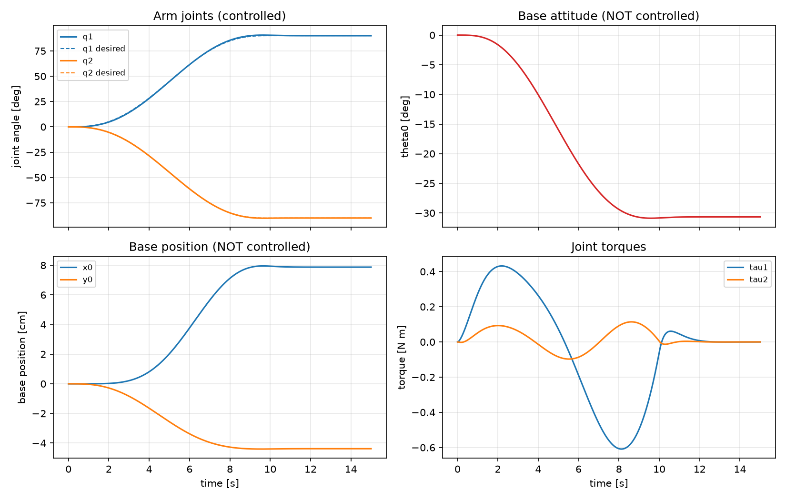
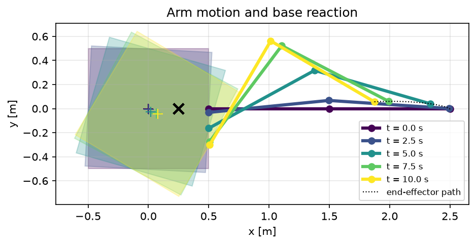
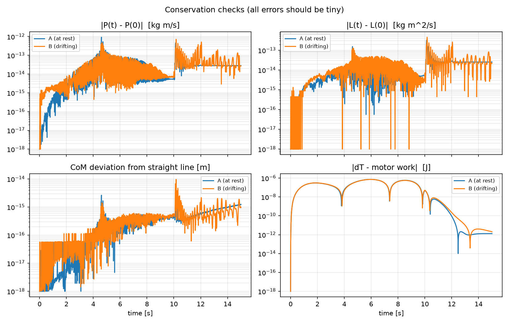

# Project 1 – Planar Free-Floating Space Manipulator


A satellite carrying a 2-link robotic arm floats freely in space (no thrusters
firing, no gravity in the orbital frame over short times). When the arm moves,
the **base translates and rotates in reaction**, because the system's total
momentum is conserved. This project derives the dynamics from first principles,
simulates a controlled arm motion, and verifies the result against the
conservation laws.

Relevant to: planning and control of space robots for autonomous assembly,
on-orbit servicing, and space-debris capture, where the base attitude
disturbance caused by the arm must be predicted and limited.

## Model

| Body | Mass | Inertia | Size |
|---|---|---|---|
| Base (square satellite) | 100 kg | 16.7 kg m² | 1 m × 1 m |
| Link 1, Link 2 (uniform rods) | 10 kg each | 0.83 kg m² each | 1 m each |

The arm is mounted at the middle of the base's right face.
Generalized coordinates (5 DOF, versus 2 for a fixed-base arm):

$$q = [x_0,\ y_0,\ \theta_0,\ q_1,\ q_2]^T$$

base position, base attitude, and the two joint angles.

## Dynamics

Lagrange's equations with kinetic energy only (no potential energy):

$$T = \sum_{i=0}^{2}\left(\tfrac12 m_i\, v_i^T v_i + \tfrac12 I_i\,\omega_i^2\right) = \tfrac12\,\dot q^T M(q)\,\dot q,
\qquad M(q) = \sum_i \left(m_i J_{v,i}^T J_{v,i} + I_i J_{\omega,i}^T J_{\omega,i}\right)$$

$$M(q)\,\ddot q + c(q,\dot q) = \tau, \qquad \tau = [0,\ 0,\ 0,\ \tau_1,\ \tau_2]^T$$

The zeros in τ are what make the robot *free-floating*: only the joints are
actuated. c is obtained from M via Christoffel symbols. Everything is derived
symbolically with SymPy and converted to NumPy (`dynamics.py`).

The base's effective inertia depends on the arm configuration:
$M_{33} = 38.3 + 15\cos q_1 + 10\cos q_2 + 5\cos(q_1+q_2)$ kg m².

## Simulation

- Joint trajectory: quintic profile (zero velocity and acceleration at the
  ends), from (0°, 0°) to (90°, −90°) in 10 s, then hold.
- Controller: joint-space PD. **The base is not controlled.**
- Integrator: SciPy `solve_ivp`, DOP853, rtol = 1e-10.



**Result:** the arm tracks its path within 0.8° using < 0.7 N m, but the base
rotates by **−30.7°** and drifts about 9 cm, with no command. Once the arm
stops, the base stops too (zero total momentum).



## Verification

1. **Model consistency (`step2_dynamics.py`):** M is symmetric and positive
   definite at 200 random configurations; the SymPy kinetic energy matches an
   independent finite-difference computation from `kinematics.py` (error 3e-8);
   the Coriolis vector matches a finite-difference $\dot M\dot q - \partial T/\partial q$ (error 2e-8).
2. **Conservation laws (`step4_conservation.py`):** for a start at rest and for
   a start with the base drifting and spinning:

| Quantity | Max error over 15 s |
|---|---|
| Linear momentum P | 9e-13 kg m/s |
| Angular momentum L | 5e-13 kg m²/s |
| System CoM vs. straight-line motion | 1e-14 m |
| Work-energy balance (ΔT − motor work) | 7e-7 J (trapezoid quadrature) |



## Files

| File | Purpose |
|---|---|
| `params.py` | masses, lengths, inertias |
| `kinematics.py` | forward kinematics, system centre of mass (NumPy) |
| `dynamics.py` | symbolic Lagrangian derivation → `M(q)`, `c(q, qd)`, forward dynamics |
| `simulation.py` | quintic trajectory, PD controller, integrator |
| `step1_draw.py` … `step5_animate.py` | reproducible scripts for each figure |

## Run

```bash
cd project1_free_floating
python step1_draw.py          # configurations
python step2_dynamics.py      # derive + check dynamics
python step3_simulate.py      # simulation and plots
python step4_conservation.py  # conservation checks
python step5_animate.py       # GIF
```

## Possible extensions

- Plan arm paths that minimize base rotation (reaction-null-space / generalized Jacobian).
- Control the end effector in inertial space using the generalized Jacobian.
- Capture of a tumbling target (contact dynamics).
- Flexible links or joints.
