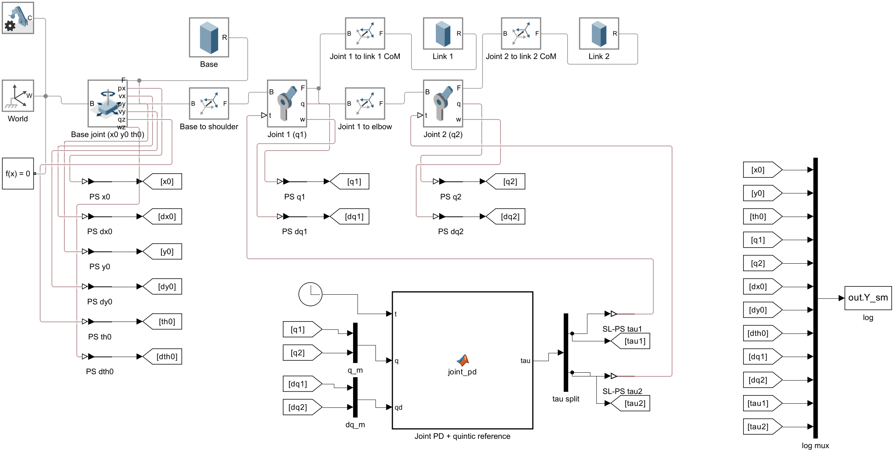
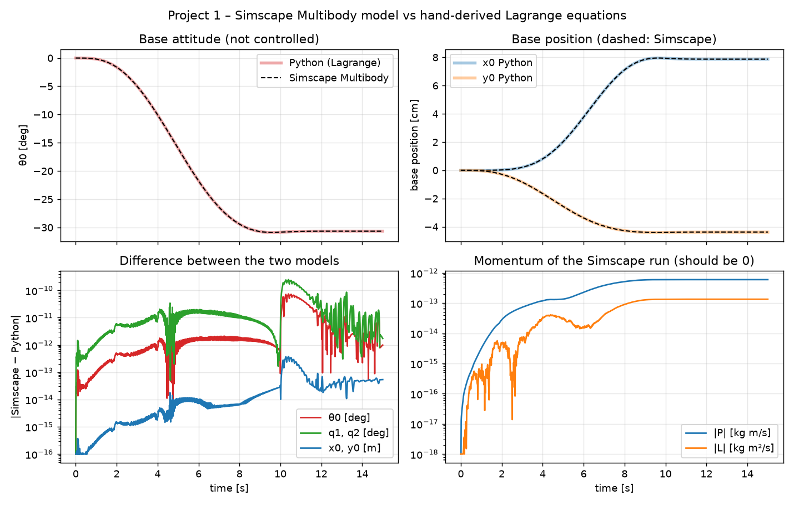
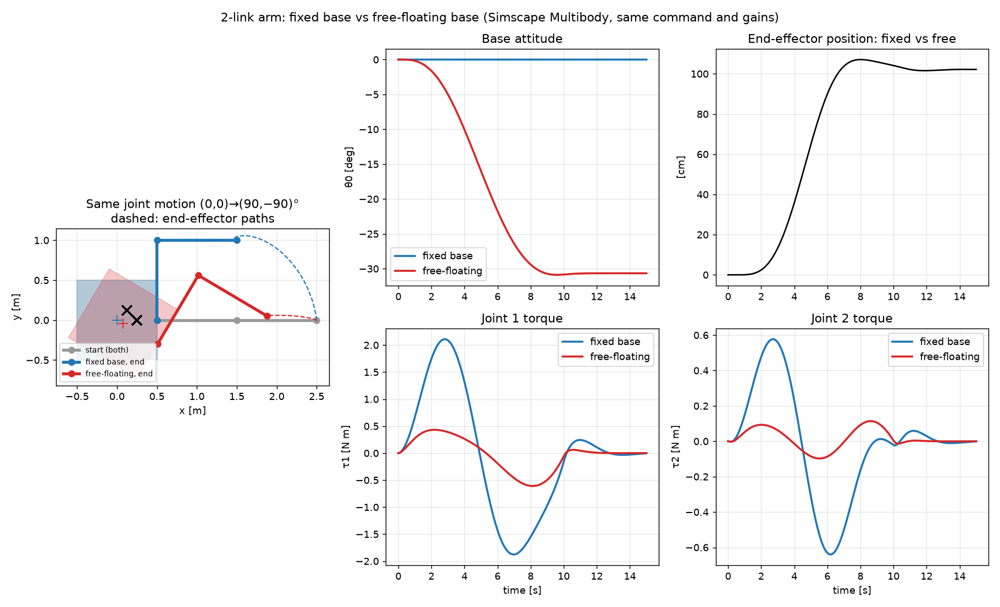

# Project 1 – Simscape Multibody cross-check

The free-floating robot of project 1 rebuilt in **Simscape Multibody** (MATLAB R2025b). Here the
robot is assembled from bodies, joints and frames, and Simscape derives the equations of motion
itself. Nothing from the hand-derived Lagrange model (`dynamics.py`) is used, so agreement between
the two is an independent check of the derivation.



## Model

| Block | Role | Values (same as `params.py`) |
|---|---|---|
| World frame + Planar Joint | base position and attitude $x_0, y_0, \theta_0$: free, **not actuated** (free-floating), only sensed | – |
| Mechanism Configuration | gravity switched off | – |
| Brick Solid "Base" | square satellite, reference frame = its centre of mass | 100 kg, $I_{zz}$ = 16.7 kg m² |
| Rigid Transform | shoulder at the middle of the base's right face | (0.5, 0) m |
| Revolute Joints $q_1, q_2$ | torque input, angle + rate sensed | – |
| Rigid Transforms + Brick Solids "Link 1/2" | link centre of mass at half length, next joint at full length | 1 m, 10 kg, $I_{zz}$ = 0.83 kg m² |
| MATLAB Function | quintic joint reference and joint PD, the same code as `simulation.py` | $K_P$ = (40, 20), $K_D$ = (30, 10) |

The model is built by a script (`build_free_floating_sm.m`), so every block and parameter is
visible in text. Only the in-plane inertia $I_{zz}$ matters for planar motion; the other two moments are
set to physically valid values. Solver: ode45, RelTol 1e-10, AbsTol 1e-12, output every 0.01 s
(the Python run's grid).

## Results

The same 10 s arm move, from (0°, 0°) to (90°, −90°):

| | Simscape | Python (Lagrange) |
|---|---|---|
| final base attitude $\theta_0$ | −30.65556° | −30.65556° |
| final base position | (7.873, −4.380) cm | (7.873, −4.380) cm |

Largest difference over the 15 s run: base position 4e-13 m, base attitude 7e-11°,
joints 3e-10°, joint torques 7e-10 N m. That is at the level of the integrator tolerances.
The same run in Gazebo (project 5) gave −30.655°.

The Simscape trajectory also conserves momentum on its own. Its linear and angular momentum stay
below 6e-13 and the system centre of mass moves by 5e-14 m. These are evaluated from the body
velocities only (`compare_simscape.py`).



The order of the planar joint's sensor ports (px, vx, py, vy, qz, wz) is checked against
Simscape's own data log (difference 0 to 1e-16).

## Same arm on a fixed base

`run_fixed_base.m` builds the same model with the base bolted to the ground (no Planar Joint),
and `compare_fixed_vs_free.py` compares the two under the same joint command and PD gains.
The fixed-base Simscape run also matches the joint rows of the Python equations with the base
frozen, $M_{mm}\ddot q_m + c_m = \tau$, to 8e-10°. So the fixed-base robot is the free-floating one
without the base coordinates: $M_{bb}$ and $M_{bm}$ are exactly what space adds.

| Same joint motion (0,0) → (90,−90)° | Fixed base | Free-floating |
|---|---|---|
| Base at the end | does not move | rotated −30.66°, moved (7.9, −4.4) cm |
| End effector at the end | (1.50, 1.00) m | (1.88, 0.05) m, **1.02 m away** |
| Peak joint torques | 2.11 / 0.64 N m | 0.61 / 0.11 N m |
| Peak joint tracking error (same gains) | 2.68° | 0.79° |

- **The end effector misses its target in space** even though the joints reach exactly the
  same angles. The joint angles no longer determine where the hand is; the base attitude and
  position (and therefore the whole path taken) matter too.
- **The arm feels lighter in space.** The base gives way when a joint pushes on it, so the motors see
  the generalized inertia $H^* = ([M^{-1}]_{mm})^{-1}$ instead of $M_{mm}$. With the arm straight, joint 1
  sees 6.85 kg m² instead of 26.67 kg m² (3.9× less). The same move therefore needs about a third of the
  torque, and the same PD gains track it better.



## Files

| File | Purpose |
|---|---|
| `build_free_floating_sm.m` | builds `free_floating_sm.slx` (or `fixed_base_sm.slx` with `fixedBase = true`) block by block |
| `run_simscape_crosscheck.m` | parameters, build, simulate, port-order check, diagram picture → `simscape_results.mat` |
| `compare_simscape.py` | comparison with the Python run + momentum check, figure |
| `run_fixed_base.m` | the same arm on a fixed base → `fixed_base_results.mat` |
| `compare_fixed_vs_free.py` | fixed vs free-floating, and fixed-base Simscape vs Python |

## Run

```bash
cd project1_free_floating/simscape
matlab -batch "run_simscape_crosscheck"     # ~1 min including MATLAB start-up
python compare_simscape.py                  # uses ../results_step3.npz (re-created if missing)
matlab -batch "run_fixed_base"
python compare_fixed_vs_free.py
```
