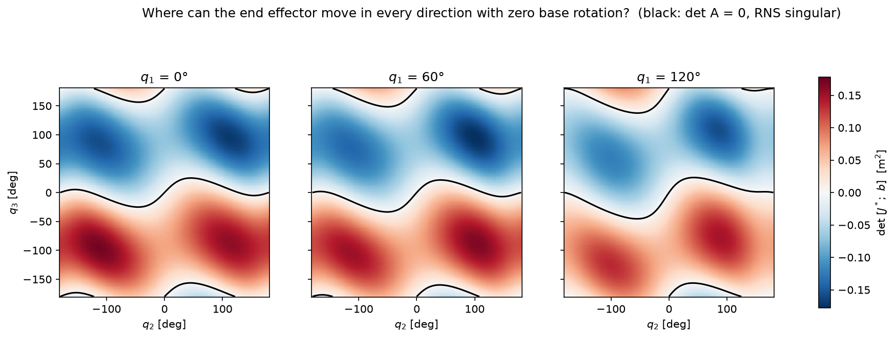
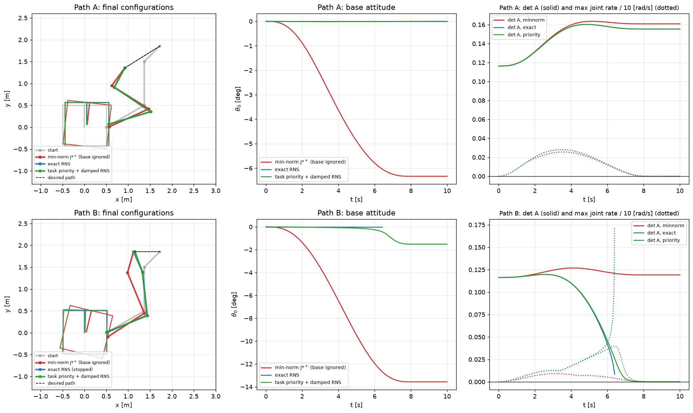
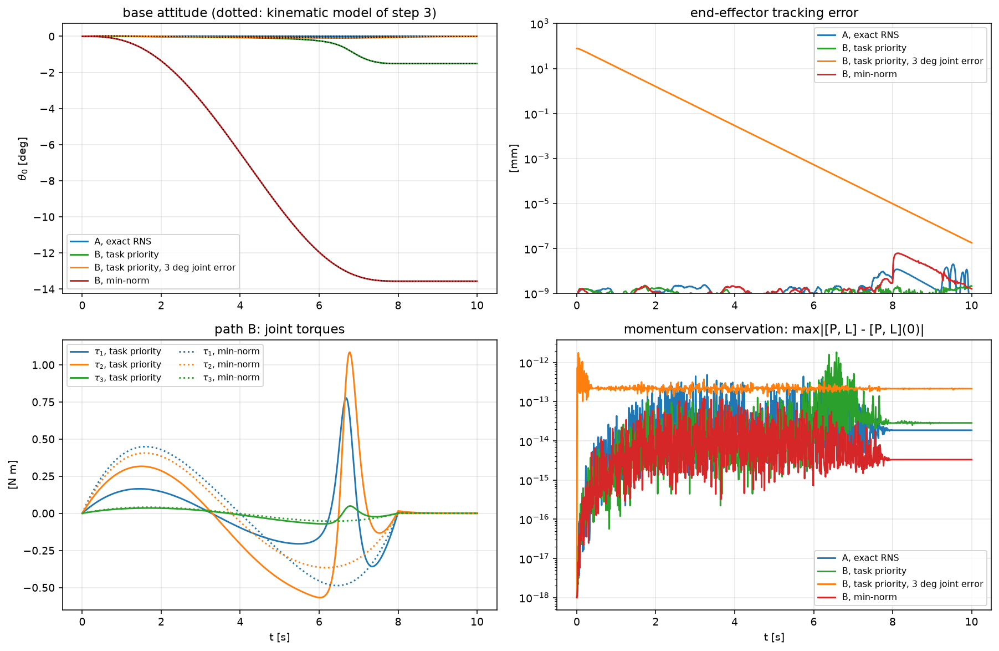
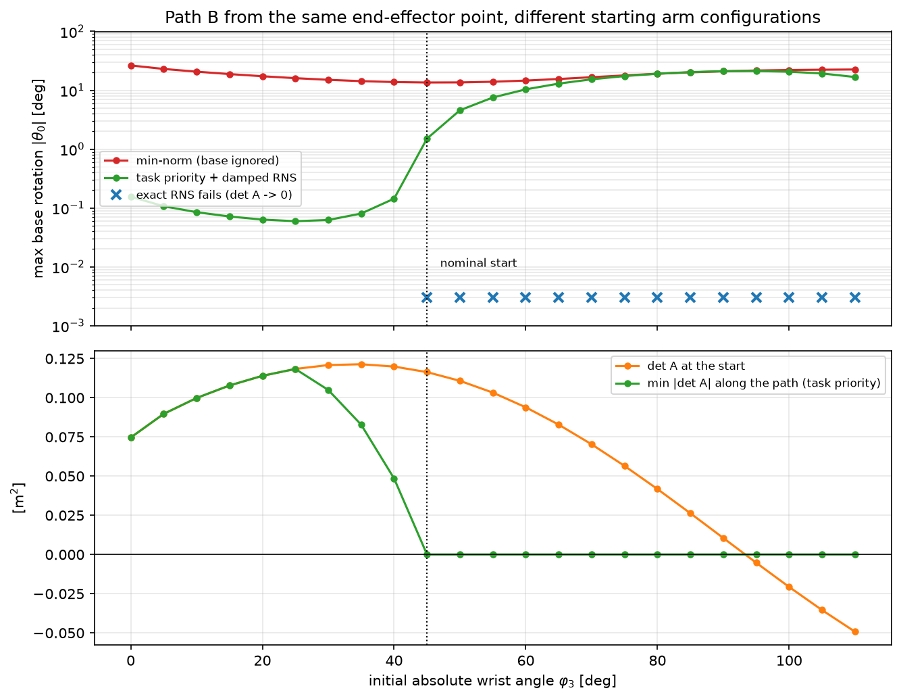

# Project 1b – Reaction Null Space: moving the arm without disturbing the base

*The same end-effector path executed three ways. Left: minimum joint motion, the base
rotates 13.6°. Middle: reaction-null-space control from the original start runs into an
RNS singularity and is left with 1.5°. Right: the same controller from a better starting
wrist angle: the base does not rotate at all.*

This extends [project 1](../project1_free_floating/) (a satellite carrying a 2-link arm).
There, every arm motion rotated the base, because a planar 2-link arm has no spare
degree of freedom: the end-effector path fixes the joint motion, and the joint motion
fixes the reaction. Here the arm gets a third link. The extra degree of freedom is used
to cancel the reaction on the base, following the **Reaction Null Space** (RNS) idea of
Nenchev, Yoshida et al., flight-tested as the "zero reaction maneuver" on ETS-VII.

Relevance: on-orbit servicing, assembly and debris capture need the satellite to keep
pointing (antennas, solar panels, cameras) while the arm works, ideally without spending
reaction-wheel momentum or propellant.

## Model

| Body | Mass | Length | Inertia |
|---|---|---|---|
| Base (square satellite, as in project 1) | 100 kg | 1 m | 16.7 kg m² |
| Link 1, link 2 | 10 kg each | 1 m each | 0.83 kg m² each |
| Link 3 (wrist) | 5 kg | 0.5 m | 0.10 kg m² |

Generalized coordinates $q = [x_0,\ y_0,\ \theta_0,\ q_1,\ q_2,\ q_3]^T$. The SymPy
Lagrangian model of project 1 is rewritten for any number of links (`model.py`).

**Checks** (`step1_model.py`): the general code builds project 1's 2-link robot and
matches its mass matrix and Coriolis vector to 4e-14; for the 3-link robot, M is symmetric
and positive definite (500 configurations), the kinetic energy and Coriolis terms agree
with an independent finite-difference computation from plain-NumPy kinematics
(4e-8, 3e-8), and a 10 s torque-driven run with a drifting, spinning base conserves the
linear momentum to 2e-10 and the angular momentum to 4e-10. The angular momentum check
must use $L_O = p_{\theta_0} + r_0 \times P$: the momentum conjugate to $\theta_0$ is
taken about the *moving* base centre and is not conserved unless $P = 0$.

## The Reaction Null Space

Starting at rest, the momentum stays zero, so the base motion is fixed by the joint rates:

$$M_{bb}\dot q_b + M_{bm}\dot q_m = 0 \quad\Rightarrow\quad \dot q_b = B(q)\,\dot q_m,\qquad B = -M_{bb}^{-1}M_{bm}$$

The third row of $B$ gives the base angular rate, $\omega_0 = b(q)\,\dot q_m$.
Joint rates in **null(b)** (a 2-D subspace for 3 joints) leave the base attitude
untouched. In the example of `step2_rns.py`, the same joint rates rotate the base by
−14.4° in 4 s when applied directly and by 2e-14° after projection onto null(b).

The end effector moves with the generalized Jacobian $J^* = J_m + J_b B$. Stacking the
task and the reaction,

$$\begin{bmatrix} v_e \\ \omega_0 \end{bmatrix} = A(q)\,\dot q_m,\qquad A = \begin{bmatrix} J^* \\ b\end{bmatrix}$$

where $\det A \neq 0$ means any end-effector velocity can be produced with exactly zero
base rotation. Where $\det A = 0$ (an **RNS singularity**) one direction is lost. Like the
dynamic singularities of project 3, these depend on the masses, not only on the geometry.

## Using the redundancy: three controllers

Every solution of $J^*\dot q_m = v$ is $\dot q_m = J^{*+}v + s\,n$, where
$n = r_1 \times r_2$ spans the null space of $J^*$ (rows $r_1, r_2$). The resulting base
rate is $\omega_0 = bJ^{*+}v + (b\cdot n)\,s$, and $b \cdot n = \det A$.
The controllers differ only in $s$ (with $v$ including end-effector position feedback
and $\omega_c = -K_\theta\,\theta_0$):

| Controller | $s$ | Behaviour |
|---|---|---|
| min-norm | $0$ | smallest joint rates, base ignored |
| exact RNS | $(\omega_c - bJ^{*+}v)/\det A$ | zero base rotation, but $s\to\infty$ as $\det A \to 0$ |
| task priority + damped RNS | $\det A\,(\omega_c - bJ^{*+}v)/(\det A^2 + \lambda^2)$ | end effector first, base second; bounded near the singularity |

Results for two straight paths (8 s, `step3_path_tracking.py`):

| | min-norm | exact RNS | task priority |
|---|---|---|---|
| Path A (0.94 m): max base rotation | 6.33° | 0.0000° | 0.017° |
| Path B (0.60 m): max base rotation | 13.56° | **fails at 6.4 s** (det A → 0) | 1.51° |
| Path B: max joint rate | 0.09 rad/s | > 10 rad/s | 0.40 rad/s |

On path B the zero-reaction motion drives the arm *onto* the RNS singularity. The
task-priority controller passes with bounded joint rates by accepting 1.5° of base
rotation, which then cannot be removed: at $\det A = 0$ the only joint motion that keeps
the end effector still does not rotate the base. A sweep of λ shows that 1.5° is the
floor for this start; a smaller λ only costs joint rate.

## Torque-level simulation

`torque_control.py` produces the motion with joint torques through the full dynamics
(base unactuated). Outer loop: the controllers above, evaluated on the actual state.
Inner loop: exact joint linearization
$\tau = H^*(a + [M^{-1}c]_m)$, $H^* = ([M^{-1}]_{mm})^{-1}$, as in project 3.

* the base attitude matches the kinematic results to between 2e-12° and 1e-7°
* linear and angular momentum stay at zero to 2e-12; the work-energy balance closes
  to the trapezoid-quadrature error of the output grid (10× finer grid → 100× smaller)
* starting with 3° joint errors (78 mm end-effector error) the error decays to
  2e-7 mm, with joint torques below 2.2 N m

## The starting configuration decides

Path B always starts from the same end-effector point, but the redundant arm can reach it
with any wrist angle in a 110° window. Running path B from every start
(`step5_start_sweep.py`):

* min-norm rotates the base 13.6–26.4° from every start
* exact RNS succeeds from 9 of 23 starts (wrist angle 0–40°) with zero base rotation and
  fails from the other 14
* the nominal start (45°) is just past the boundary: from 25° the task-priority
  controller keeps the base within 0.06° (versus 1.51°)

So whether the base must rotate is decided **before** the motion starts, by the arm
configuration the planner chooses. Zero-reaction control is a planning problem as much
as a control problem.

## Files

| File | Content |
|---|---|
| `params.py` | masses, lengths, inertias |
| `kinematics.py` | plain-NumPy forward kinematics, wrist-angle inverse kinematics |
| `model.py` | n-link SymPy model: M, c, momentum, end-effector Jacobians |
| `rns.py` | B, b, null-space projector, generalized and extended Jacobians |
| `path_tracking.py` | min-norm / exact RNS / task-priority controllers, kinematic simulation |
| `torque_control.py` | exact joint linearization, full-dynamics simulation |
| `step1_model.py` … `step5_animate.py` | one script per result above |

Run from this folder, e.g. `python step3_path_tracking.py` (each script takes under a
minute; building the SymPy model takes ~23 s).

## References

* D. N. Nenchev, K. Yoshida, P. Vichitkulsawat, M. Uchiyama, "Reaction null-space
  control of flexible structure mounted manipulator systems," *IEEE Trans. Robotics and
  Automation*, 15(6), 1011–1023, 1999.
* K. Yoshida, K. Hashizume, S. Abiko, "Zero reaction maneuver: flight validation with
  ETS-VII space robot and extension to kinematically redundant arm," *IEEE ICRA*, 441–446, 2001.
* Y. Umetani, K. Yoshida, "Resolved motion rate control of space manipulators with
  generalized Jacobian matrix," *IEEE Trans. Robotics and Automation*, 5(3), 303–314, 1989.
