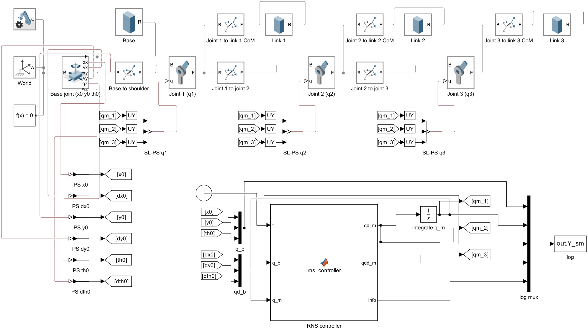
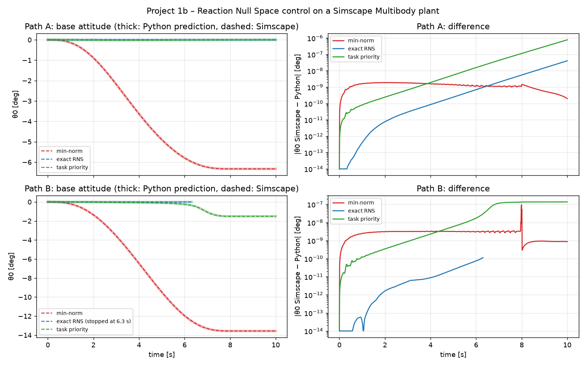

# Project 1b – Reaction Null Space control on a Simscape Multibody plant

The controllers of [step 3](../step3_path_tracking.py) (min-norm, exact RNS, task priority) driving
the 3-link free-floating robot built in **Simscape Multibody** (MATLAB R2025b).

In the Python version the base motion is a **prediction**: $\dot q_b = B(q)\thinspace\dot q_m$ from
momentum conservation with the hand-derived inertia matrix. Here the controller only commands the
joints, and the base moves however Simscape's multibody physics says it must. If the Reaction Null
Space idea and the model behind it are right, the base of the exact-RNS robot does not rotate in
Simscape either.



## Model

- **Plant:** base on a Planar Joint ($x_0, y_0, \theta_0$ free, not actuated, sensed), three Revolute
  Joints driven by **motion** (they follow $q_m(t)$ exactly; Simscape computes the torques), Brick
  Solids with the masses and inertias of `params.py` (links 1/1/0.5 m, 10/10/5 kg), gravity off.
- **Controller** (`rns_controller.m`, in a MATLAB Function block): the same law as `path_tracking.py`,
  evaluated on the base pose **measured** in Simscape,

```math
v = v_{des} + K_P (x_{des} - x_e),\qquad \dot q_m = J^{*+} v + s\thinspace n,\qquad n = r_1 \times r_2
```

  with $s$ = 0 (min-norm), $(\omega_c - bJ^{*+}v)/\det A$ (exact RNS) or the damped task-priority
  value, $\omega_c = -K_\theta\theta_0$. Its inertia matrix is computed numerically from the body
  Jacobians, $M = \sum (m J_v^T J_v + I J_\omega^T J_\omega)$: that is the controller's *model*.
- $q_m$ is the integral of $\dot q_m$; $\ddot q_m$ (needed for motion actuation) is the time derivative
  of the law by central difference.
- Start $q_m$ = (30°, 60°, −45°); path A: 0.94 m down-left, path B: 0.60 m left, both in 8 s.
  Exact RNS on path B is stopped at 6.3 s, just before it reaches the RNS singularity
  (det A → 0, joint rates → ∞) at 6.4 s.

## Results

| Path, controller | max \|θ0\| Simscape | max \|θ0\| Python | max difference in θ0 |
|---|---|---|---|
| A, min-norm | 6.3303° | 6.3303° | 2e-9° |
| A, exact RNS | 0.0000° | 0.0000° | 4e-8° |
| A, task priority | 0.0170° | 0.0170° | 8e-7° |
| B, min-norm | 13.5645° | 13.5645° | 9e-8° |
| B, exact RNS (to 6.3 s) | 0.0000° | 0.0000° | 1e-10° |
| B, task priority | 1.5102° | 1.5102° | 1e-7° |

Base position agrees to 1.4e-9 m and det A to 3e-9 in every case. The physics engine confirms that
joint motion in the reaction null space leaves the base attitude unchanged, and that the 1.51° on
path B is the price of passing the RNS singularity, not a modelling error.



Note: Simscape treats its outputs as depending directly on the motion inputs, so Simulink reports
an algebraic loop through the controller and solves it at every step (the diagnostic is switched
off in the model).

## Files

| File | Purpose |
|---|---|
| `build_rns_sm.m` | builds `rns_sm.slx` block by block |
| `rns_controller.m` | control law (also the code of the MATLAB Function block) |
| `run_rns_simscape.m` | parameters, six runs → `rns_simscape_results.mat`, diagram picture |
| `compare_rns_simscape.py` | runs `path_tracking.track()` for the same cases and compares |

## Run

```bash
cd project1b_reaction_null_space/simscape
matlab -batch "run_rns_simscape"          # ~2 min including MATLAB start-up
python compare_rns_simscape.py            # ~1 min (builds the SymPy model)
```
