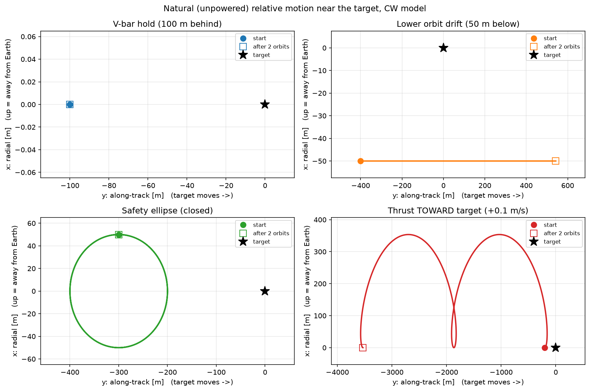
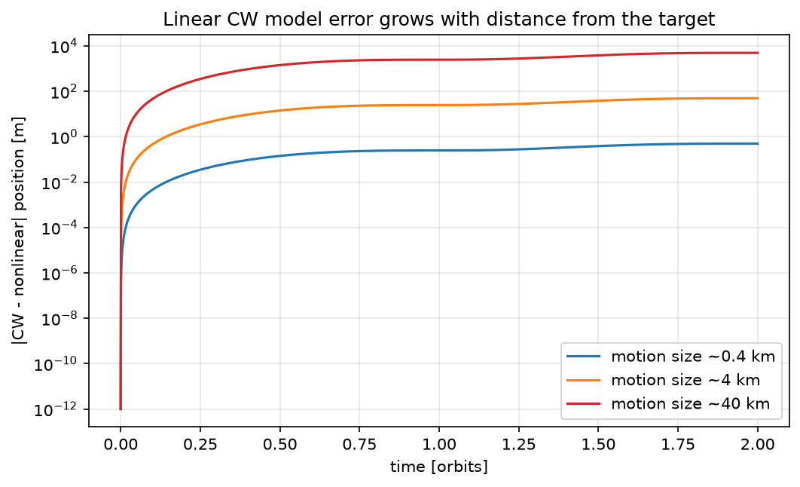
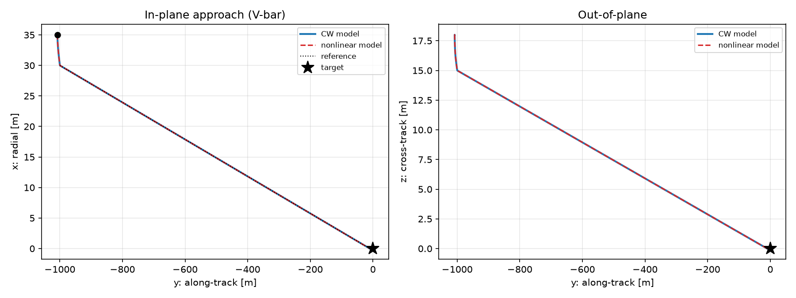
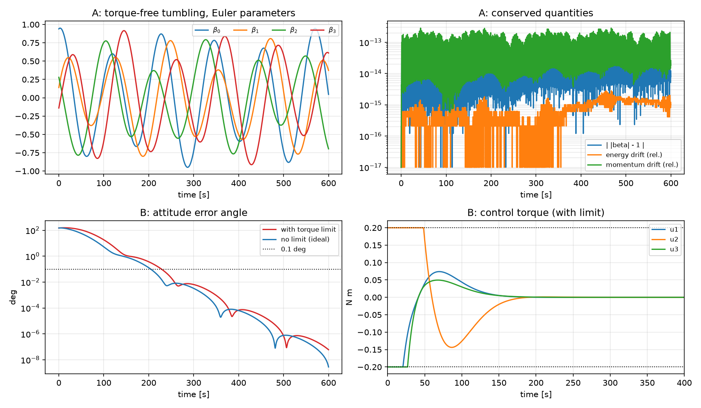
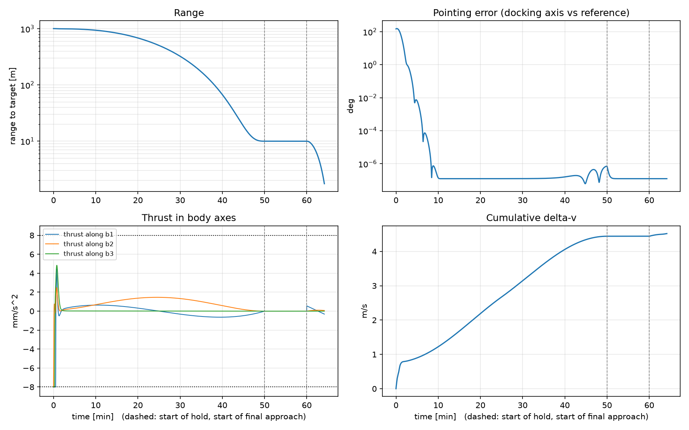
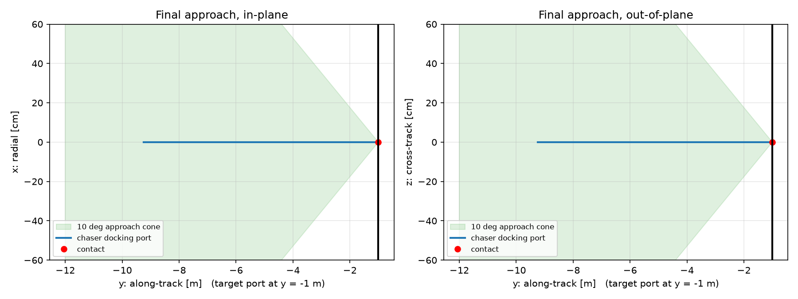
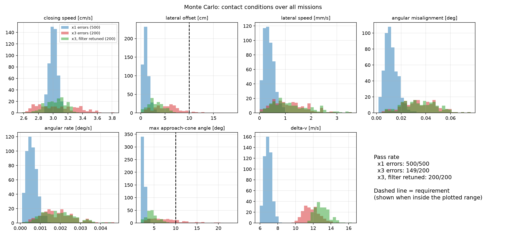
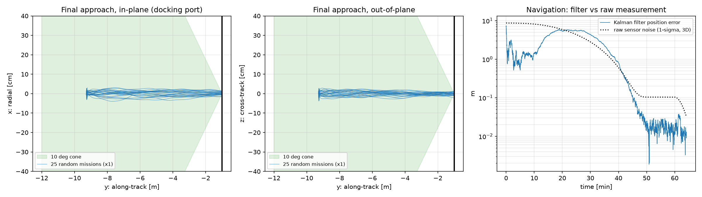

# Project 2 – Autonomous Rendezvous and Docking


A 500 kg chaser spacecraft starts about 1 km behind a target in a 400 km circular
orbit, tumbling and pointing the wrong way. It must approach along the target's
velocity direction (V-bar), hold at 10 m, and dock at ~3 cm/s with its docking
port aligned. The project covers the full guidance, navigation and control (GNC)
chain and then tests it with 1 400 Monte Carlo missions under realistic errors.

Relevant to: autonomous rendezvous, proximity operations and docking (RPOD);
robust control of in-orbit systems under parametric uncertainty.

## 1. Relative orbital motion

Close to the target, the chaser's motion in the target's LVLH frame
(x radial, y along-track, z orbit normal) follows the Clohessy–Wiltshire equations:

$$\ddot x - 3n^2x - 2n\dot y = a_x,\qquad \ddot y + 2n\dot x = a_y,\qquad \ddot z + n^2 z = a_z$$

with mean motion $n=\sqrt{\mu/a^3}$ (92.6 min period at 400 km).



Four classic unpowered motions, each matching its closed-form prediction:
V-bar hold point (equilibrium), drift from a lower orbit (−3πx₀ = 471 m per orbit),
a closed safety ellipse, and the counter-intuitive result of thrusting *toward*
the target (the chaser ends 3.5 km *behind* after two orbits).

**Checks:** numerical CW vs. closed-form state transition matrix: 1e-8 m.
LVLH ↔ ECI round trip: 3e-10. CW vs. full nonlinear two-body motion: error grows
quadratically with distance (0.1 % at 400 m, 12 % at 40 km), so CW is accurate for
the final phase.



## 2. Translation control (LQR)

$$u = u_{ff}(t) - K\,(s - s_{ref}(t)),\qquad K = R^{-1}B^TP\ \text{(continuous Riccati equation on the CW model)}$$

- Reference: smooth (quintic) path along the V-bar to the 10 m hold point.
- Feedforward $u_{ff}$ includes the Coriolis term $-2n\dot y_{ref}$ needed to fly a
  straight line in a rotating frame (this dominates the fuel cost).
- Weights by Bryson's rule; thrust limited to 4 N per axis (8 mm/s²).

Works identically on the CW and the nonlinear model (0.07 mm difference);
Δv 4.5 m/s, matching a hand estimate (2n·990 m + 2·peak speed + start-error correction).



## 3. Attitude (Euler parameters)

$$\dot\beta = \tfrac12[B(\beta)]\,\omega,\qquad J\dot\omega = -\omega\times J\omega + u$$

Lyapunov-based tracking law (Schaub & Junkins):

$$u = -K\epsilon - P\,\delta\omega + J\,{}^B\dot\omega_r + \omega\times J\omega,\qquad
V = \tfrac12\delta\omega^TJ\delta\omega + 2K(1-\epsilon_0),\quad \dot V = -\delta\omega^TP\,\delta\omega \le 0$$

The docking axis b₁ tracks the line of sight to the target, which rotates once per orbit.

- Torque-free checks over 600 s: |β| = 1 within 1e-13, energy 3e-15, inertial
  angular momentum 2e-13, EP-propagated DCM vs. directly integrated DCM 6e-11.
- From a 150° error while tumbling: < 0.1° in 205 s (229 s with a 0.2 N m wheel limit).
  With saturation V is no longer monotonic, so the Lyapunov guarantee is lost —
  the response still converges here.



## 4. Full docking mission

Translation and attitude run together on the nonlinear model. Thrusters are
**body-fixed**: the LQR command is rotated into body axes and limited per axis,
so the attitude affects the translation.



| Contact condition (assumed requirement) | Result (ideal case) |
|---|---|
| Closing speed 1–10 cm/s | 3.0 cm/s |
| Lateral offset < 10 cm | < 1e-9 m |
| Lateral speed < 2 cm/s | 2e-8 m/s |
| Angular misalignment < 5° | 1e-7° |
| Angular rate < 0.2°/s | 4e-13 °/s |
| 10° approach cone | max 2.3° |



## 5. Robustness: Monte Carlo

The ideal case is too perfect. The Monte Carlo version adds:

- **Flight software at 1 Hz** with zero-order hold (it reproduces the ideal case when all errors are zero).
- **Navigation:** the sensor gives only noisy relative position (1 cm + 0.5 % of range);
  a **Kalman filter** on the CW model (exact discretization) estimates position and velocity.
  Feeding raw measurements to the LQR instead cost ~10× more Δv.
- **Hardware/model errors:** mass and inertia ±10 %, thruster misalignment 1°, thrust
  magnitude 3 %, differential drag, star-tracker and gyro noise.
- **Random start:** position ±10 m, velocity ±2 cm/s, any attitude, ~1°/s tumble.

| Campaign | Errors | Filter tuning | Missions passed | Worst lateral offset | Worst cone angle | Mean Δv |
|---|---|---|---|---|---|---|
| A | ×1 | original | **500 / 500** | 3.4 cm | 4.1° | 6.9 m/s |
| B | ×3 | original | 149 / 200 | 19.0 cm | 23.4° | 11.8 m/s |
| C | ×3 | retuned | **200 / 200** | 8.0 cm | 8.4° | 13.0 m/s |
| D | ×1 | retuned | **500 / 500** | 2.6 cm | 3.9° | 7.8 m/s |

**Finding:** all failures in B came from the navigation filter, not the control law.
Its process noise was tuned for the ×1 errors, so with ×3 thruster and mass errors
it trusted its model too much and its estimate drifted. Raising it 4× fixed every
failure, at the cost of more Δv (the filter reacts more to noise).
Campaign D flies the same 500 missions as A with the retuned filter: still 100 %
success and slightly better accuracy (lateral offset −0.25 cm on average), for
+0.85 m/s of Δv (+12 %). The retuned filter is the safer choice; the original one
is ~12 % cheaper if the hardware errors are known to stay small.




## Limitations

- Circular target orbit, point-mass gravity (no J2, no eccentricity), target holds LVLH attitude.
- Contact requirements are assumed values of realistic magnitude, not from a specific docking system.
- No contact/capture dynamics, plume impingement, actuator dynamics, or wheel momentum saturation.
- Sensor noise is white; real sensors have biases and correlated errors.

## Files

| File | Purpose |
|---|---|
| `orbit.py` | CW model (rhs, A/B, STM), two-body model, ECI ↔ LVLH |
| `translation_control.py` | LQR design, reference path, feedforward |
| `attitude.py` | EP kinematics/dynamics, EP ↔ DCM (Sheppard), Lyapunov tracking law |
| `mission.py` | three-phase guidance, docking geometry, requirements |
| `montecarlo.py` | 1 Hz flight software, Kalman filter, error models |
| `step1_cw.py` … `step5_animate.py` | reproducible script for each result |

## Run

```bash
cd project2_rendezvous
python step1_cw.py            # relative motion + checks              (~7 s)
python step2_lqr_approach.py  # LQR approach                          (~10 s)
python step3_attitude.py      # attitude checks + pointing            (~7 s)
python step4_docking.py       # full mission                          (~70 s)
python step4b_montecarlo.py   # campaigns A and B (parallel)          (~30 min)
python step4b_retuned.py      # campaign C;  add "1" for campaign D
python step4b_analysis.py     # statistics + figures
python step5_animate.py       # GIF                                   (~1 min)
```

## References

- W. H. Clohessy, R. S. Wiltshire, "Terminal Guidance System for Satellite Rendezvous", *J. Aerospace Sciences* 27(9), 1960.
- W. Fehse, *Automated Rendezvous and Docking of Spacecraft*, Cambridge University Press, 2003.
- H. D. Curtis, *Orbital Mechanics for Engineering Students*, ch. 7.
- H. Schaub, J. L. Junkins, *Analytical Mechanics of Space Systems* (attitude kinematics and Lyapunov control).
- MIT OCW 16.346 Astrodynamics, lecture 26: The Clohessy–Wiltshire equations.
