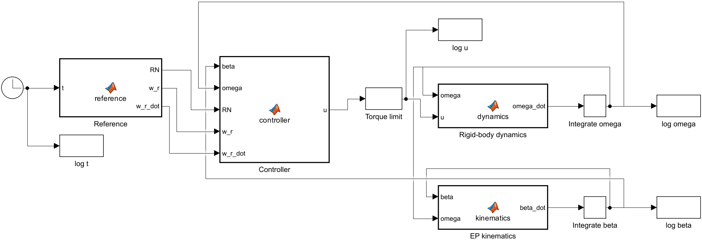
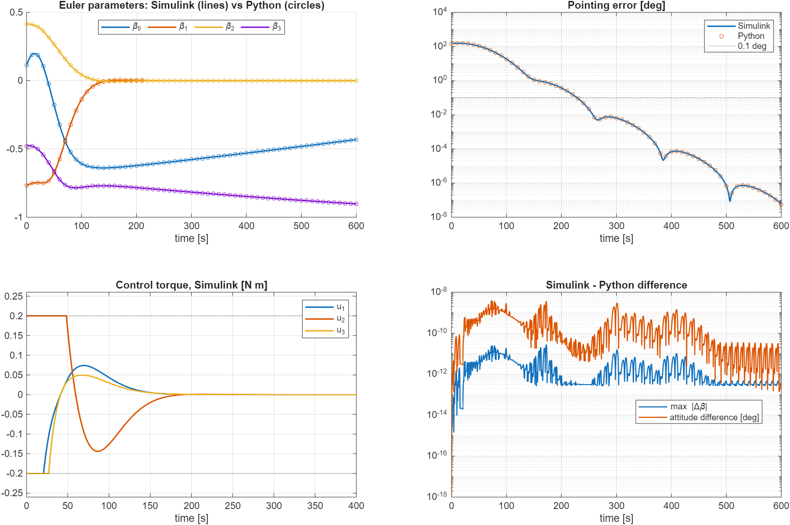

# Simulink cross-check of the attitude controller

The step 3 attitude loop (Euler-parameter kinematics, Euler's rotational
equations, Lyapunov tracking law, 0.2 N m torque limit) rebuilt in Simulink and
compared sample by sample with the Python simulation.



The model is generated by a script (`build_attitude_model.m`), so it is fully
reproducible and reviewable as text; `attitude_control.slx` is the saved result.
Integrators hold the states (β, ω); MATLAB Function blocks hold the equations;
the torque limit is a standard Saturation block.

## Result (600 s, 150° initial error, tumbling start)

| Quantity | Max difference Simulink vs Python |
|---|---|
| Euler parameters β | 2.7e-11 |
| Angular velocity ω | 4.2e-12 rad/s |
| Control torque u | 6.2e-11 N m |
| Attitude (principal angle) | 3.9e-9 deg |

Both reach a 0.1° pointing error at 228.6 s and end at 6.0e-8°.
The differences are at the level of the solver tolerances (ode45 vs DOP853,
rtol 1e-11), so the two independent implementations agree.



## Run

```bash
python export_for_simulink.py          # scenario + Python results -> crosscheck_data.mat
matlab -batch "run_crosscheck"         # build model, simulate, compare, plot
```

Requires MATLAB + Simulink (tested on R2025b).
