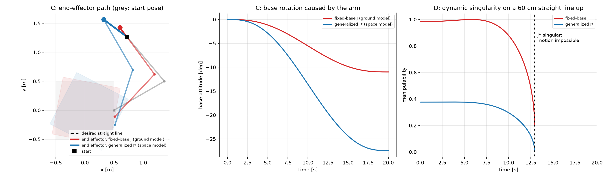
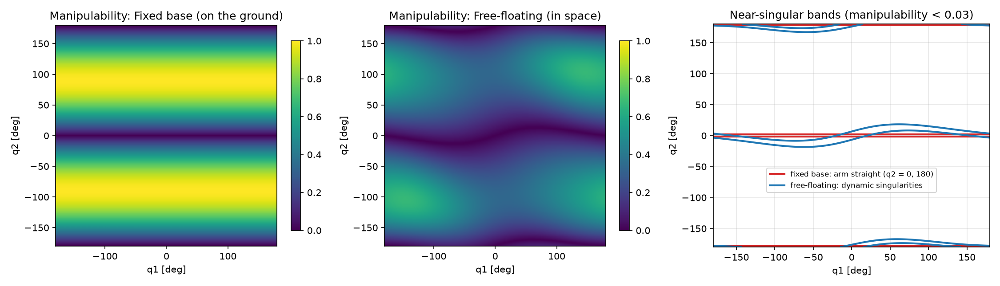
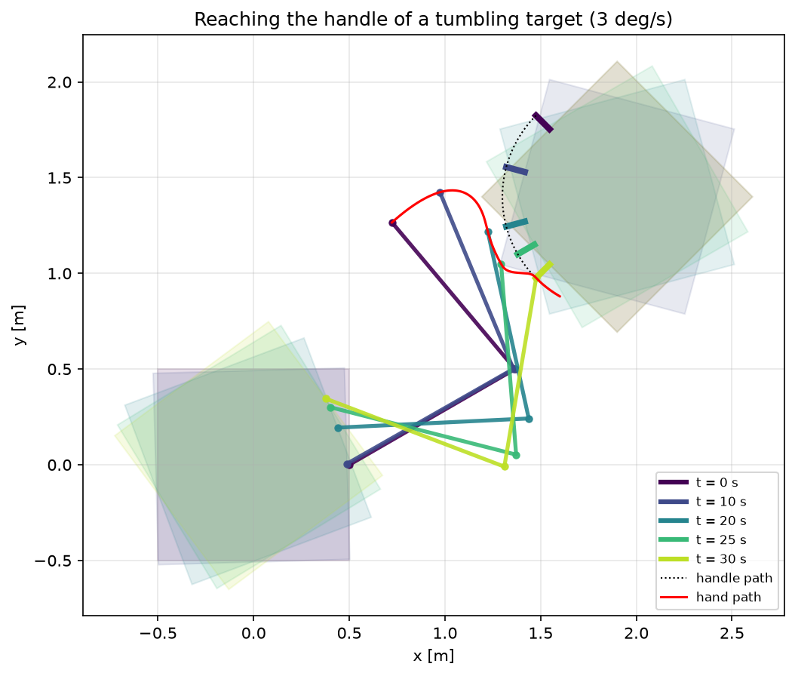
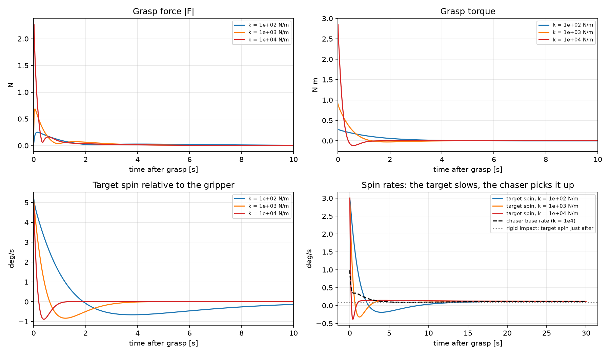
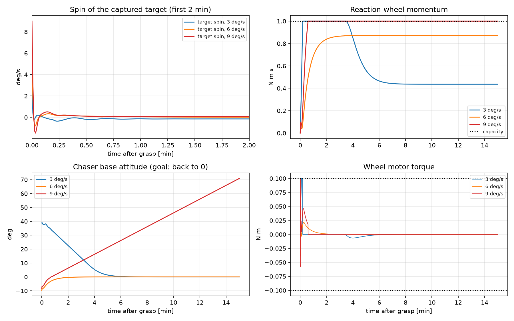
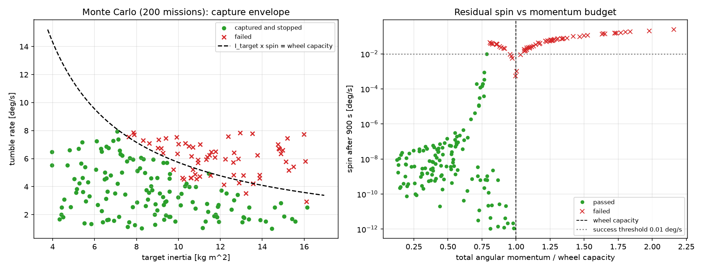

# Project 3 – Capturing a Tumbling Piece of Debris


The free-floating robot of [project 1](../project1_free_floating/) (100 kg base,
two 1 m / 10 kg links) captures a tumbling piece of debris: a 1 m, 50 kg plate
spinning at 3°/s with a grasp handle on one edge. The sequence is

1. **reach** the moving handle (generalized Jacobian control),
2. **grasp** it (compliant gripper vs. rigid-impact model),
3. **detumble** the captured stack with a reaction wheel,

followed by a Monte Carlo study over the unknown properties of the debris.

Relevant to: space robot manipulators for debris removal; contact dynamics and
physical interaction; planning and control of free-floating systems.

**Is the target realistic?** 50 kg and ~1 m is a typical dead microsatellite
(the same order as debris-removal demonstration targets), and a few °/s is a
typical tumble rate. Simplifications: planar motion, a plate instead of a 3D
body, and a fairly light chaser (real removal spacecraft are usually heavier,
which makes them less disturbed by the target).

## 1. Generalized Jacobian

With zero total momentum the base velocity is fixed by the joint velocities,
$M_{bb}\dot q_b + M_{bm}\dot q_m = 0$, so the end-effector velocity is

$$v_e = J^*\dot q_m,\qquad J^* = J_m - J_b M_{bb}^{-1}M_{bm}$$

(Umetani & Yoshida, 1989). $J^*$ depends on masses and inertias, not only on geometry.

- Verified on the project 1 dynamic simulation: base velocity prediction 8e-15, $J^*\dot q_m$ vs. true hand velocity 1e-14 m/s.
- The space arm is less capable: manipulability is lower than on the ground in 95 % of joint space (mean 0.31 vs 0.63).
- A 50 cm straight line: the ground Jacobian misses by 31 cm, $J^*$ follows it exactly.
- **Dynamic singularity** (Papadopoulos & Dubowsky): a 60 cm line upwards stops after 46 cm, where $J^*$ is singular although the arm is not stretched (fixed-base manipulability still 0.21). These singularities depend on the path, not only on the arm shape.




## 2. Reaching the moving handle

Guidance: approach a pre-grasp point 10 cm outside the handle (moving with the
target) → synchronize → close in → track. Control in two layers:

$$\dot q_{m,des} = J^{*+}\left(v_{ref} + K_p(p_{ref}-p_e)\right)$$

with a damped least-squares inverse (safe near singularities), and an exact
linearization of the free-floating joint dynamics using the generalized inertia
matrix $H^* = \left([M^{-1}]_{mm}\right)^{-1}$:

$$\tau = H^*\left(K_v(\dot q_{m,des}-\dot q_m) - \ddot q_{m0}\right)$$

Result: hand–handle distance ≤ 1.1 mm and relative speed ≤ 1.3 mm/s at grasp,
torques ≤ 0.2 N m, minimum manipulability 0.32. The base rotates 41° on its own.



## 3. Grasp contact

- **Compliant gripper:** translational + rotational spring-damper between hand and handle (locks the relative angle at closing). Both bodies receive the force at the same point, so momentum is conserved to 1e-15.
- **Rigid impact:** $Mu^+ = Mu^- + A^T\lambda,\ Au^+ = 0 \Rightarrow \lambda = -(AM^{-1}A^T)^{-1}Au^-$.

The hand matches the handle's position but not its spin (5.2°/s relative), which
causes most of the impact. Peak force grows with gripper stiffness
(0.25 N at 100 N/m, 0.69 N at 1000 N/m, 2.3 N at 10 000 N/m) while the stretch
shrinks (1.3 → 0.17 mm). After the grasp the stack spins at 0.1165°/s; the
rigid-body prediction $L_{cm}/I_{sys}$ gives 0.1166°/s.
**The arm cannot remove angular momentum, only share it.**



## 4. Detumbling with a reaction wheel

A 1 N m s / 0.1 N m wheel on the base absorbs the stack's angular momentum and
returns the base to its original attitude; the arm joints hold their angles.

| Tumble rate | L / wheel capacity | Result | Check |
|---|---|---|---|
| 3°/s | 44 % | stopped, base back to 0.000° | wheel ends at L = 0.436 N m s |
| 6°/s | 87 % | stopped, base back to 0.000° | wheel ends at L = 0.873 N m s |
| 9°/s | 131 % | cannot be stopped | residual (L − H)/I = 0.0827°/s, simulated 0.0827°/s |

When the wheel is saturated, the return slew is limited to (H − L)/I = 0.148°/s
(observed 0.148°/s). Total angular momentum including the rotor is conserved to 1e-14.



## 5. Robustness: unknown debris (Monte Carlo)

200 missions with random debris properties, the controllers keeping their
nominal tuning (50 kg target):

- target mass 30–80 kg, inertia 0.7–1.3 × the uniform-plate value,
- tumble rate 1–8°/s (deliberately across the wheel limit),
- gripper closing time 30–34 s, gripper stiffness 0.5–2 × nominal.

Success = the gripper holds (force < 10 N, torque < 10 N m, stretch < 1 cm) **and**
the stack is stopped (< 0.01°/s) with the base back within 1° after 15 min.

| Result | Value |
|---|---|
| Missions passed | **136 / 200 (68 %)** |
| Grasp held | **200 / 200** (worst force 2.8 N, torque 2.7 N m, stretch 1.8 mm) |
| Angular momentum conservation | ≤ 1.8e-13 in every mission |
| Over-capacity missions: residual spin vs (L − H)/I | agree to 2.4e-9 °/s |
| Pass/fail predicted by "L < wheel capacity" | 185 / 200 |
| ... adding the time to slew back with the spare momentum | 191 / 200 (the 9 misses are borderline cases) |

**Finding:** the grasp is never the limiting factor; the reaction wheel's momentum
budget is. It decides first whether the spin can be absorbed at all
(L < H, the dashed curve in the left plot), and then how fast the chaser can
re-point with the remaining capacity, (H − L)/I. All 15 failures with L < H
stopped the spin but could not turn the base back within 15 minutes.



## Limitations

- Planar model; the gripper matches the handle position, not its orientation (a 2-link arm has too few joints).
- Target motion (spin, phase, centre of mass) is assumed known exactly before the grasp; no vision/estimation.
- No arm–target collision checking (none occurs in the shown runs), no joint flexibility, no friction.
- The chaser's translational drift after capture is not controlled (no thrusters).

## Files

| File | Purpose |
|---|---|
| `gen_jacobian.py` | generalized Jacobian, base coupling, manipulability |
| `target.py` | tumbling target and handle motion |
| `reach_control.py` | guidance phases, damped J* resolved-rate + exact joint linearization |
| `contact.py` | compliant gripper, rigid impact, coupled chaser–target dynamics |
| `capture.py` | full sequence with the reaction wheel |
| `step1_*.py` … `step5_*.py` | one script per result |

## Run

```bash
cd project3_debris_capture
python step1_gen_jacobian.py   # ~15 s
python step2_reach.py          # ~13 s
python step3_grasp.py          # ~30 s
python step4_detumble.py       # ~1.5 min (3 runs in parallel)
python step5_montecarlo.py     # ~30-40 min (parallel), then:
python step5_analysis.py
python step5_animate.py
```

## References

- Y. Umetani, K. Yoshida, "Resolved motion rate control of space manipulators with generalized Jacobian matrix", *IEEE Trans. Robotics and Automation*, 1989.
- E. Papadopoulos, S. Dubowsky, "Dynamic singularities in free-floating space manipulators", *ASME J. Dynamic Systems, Measurement, and Control* (early 1990s).
- K. Yoshida, "Engineering test satellite VII flight experiments for space robot dynamics and control", *Int. J. Robotics Research*, 2003.
- S. Dubowsky, E. Papadopoulos, "The kinematics, dynamics, and control of free-flying and free-floating space robotic systems", *IEEE Trans. Robotics and Automation*, 1993.
