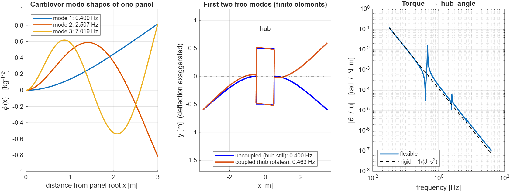

# Project 4 – Spacecraft with flexible solar panels (MATLAB)

A satellite bus carrying two long, light solar panels slews about one axis. The panels
bend, so a fast slew leaves them vibrating, and the controller has to work without
knowing exactly how stiff they are. This is the PhD topic *"Robust control of in-orbit
robotic systems in the presence of unknown flexibilities and parametric uncertainty"*,
in its simplest form.

Everything in this project is MATLAB (Control System and Robust Control Toolboxes).

## Plan

1. **Model**: rigid hub + cantilever bending modes (hybrid model), checked against an independent finite-element model. *(done)*
2. **Baseline slew with PD control**: rigid-body design, then measure the panel vibration it causes.
3. **Input shaping**: ZV / ZVD command shaping and its sensitivity to errors in the panel frequency.
4. **Robust control**: uncertain panel stiffness and damping, an H∞ / μ-synthesis controller, worst-case analysis, comparison with steps 2 and 3.
5. **Simulink, animation and write-up.**

## Step 1 – model

| | |
|---|---|
| hub inertia | 150 kg m² |
| panels | 2 × 3 m, 2 kg/m (6 kg each), root 0.5 m from the axis |
| bending stiffness EI | 82.8 N m² (first cantilever mode 0.40 Hz) |
| whole spacecraft, rigid | J = 207 kg m² (panels are 27.5 %) |
| modal damping | ζ = 0.5 % |

Each panel deflects as $w(x,t)=\sum_i \phi_i(x)\,\eta_i(t)$ with the clamped–free beam modes
$\phi_i$ (normalised so $\rho\int\phi_i^2dx = 1$). A panel element at distance $r+x$ from the
axis moves at $(r+x)\dot\theta+\dot w$, and Lagrange's equations give

$$
J\ddot\theta+\sum_{k=1,2}\delta^T\ddot\eta_k=u,\qquad
\ddot\eta_k+2\zeta\Omega\dot\eta_k+\Omega^2\eta_k+\delta\,\ddot\theta=0,
\qquad \delta_i=\rho\int_0^L (r+x)\,\phi_i(x)\,dx .
$$

**Checks** (`step1_model.m`):

- Cantilever frequencies from $1+\cos\beta L\cosh\beta L=0$ agree with a 40-element
  finite-element beam to 1e-8 – 1e-6.
- The finite-element model of the *free* spacecraft (different coordinates: inertial
  node displacements, no mode shapes) and the hybrid model give the same free
  frequencies; the error of the hybrid model shrinks as modes are added
  (first coupled mode: 9e-5 with 1 mode, 6e-9 with 5).
- One-mode hand formula $\omega=\Omega_1/\sqrt{1-2\delta_1^2/J}$ gives 0.4635 Hz (FE: 0.4634 Hz).
- $\sum_i\delta_i^2\to\rho\int(r+x)^2dx$ (the panel's inertia); the first mode alone carries 92.7 %.
- Torque → hub angle: after removing the 6 states that the torque cannot move,
  the zeros sit at the cantilever frequencies and the poles just above them
  (0.400/0.463 Hz, 2.507/2.531 Hz, 7.019/7.033 Hz) – the pole/zero alternation of a
  collocated actuator and sensor.

Run: `matlab -batch step1_model` in this folder.
