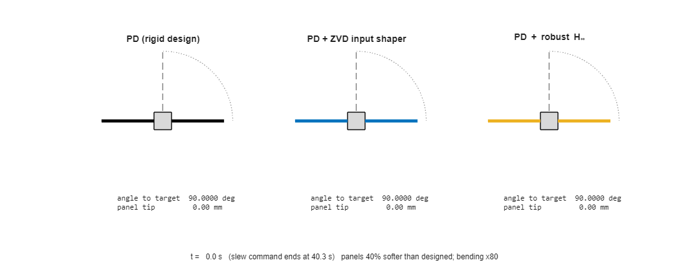
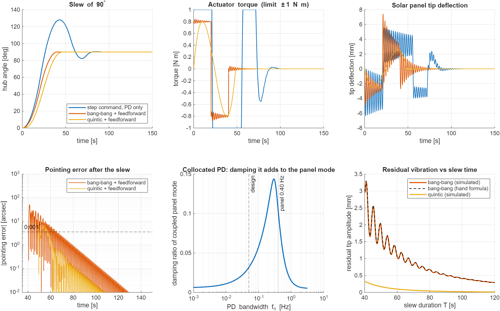
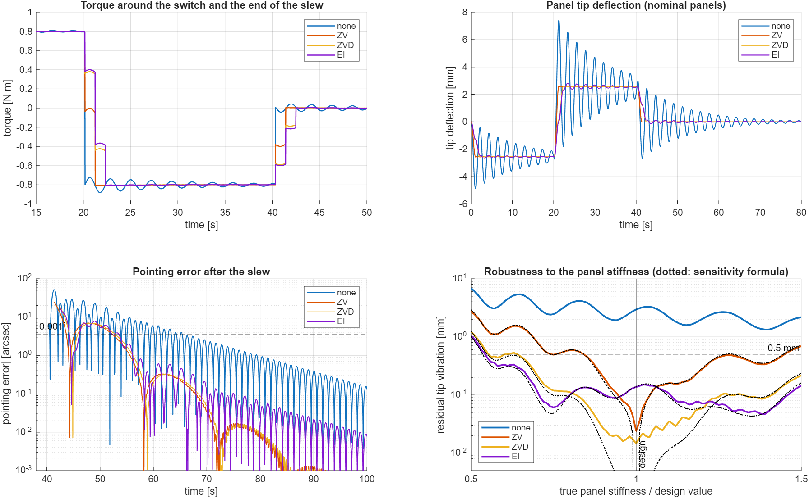
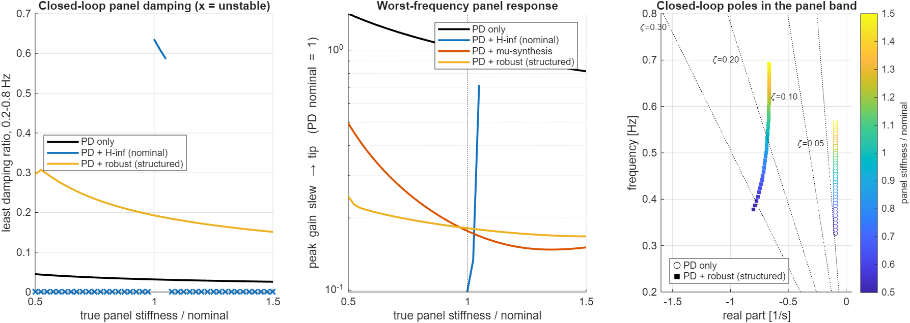
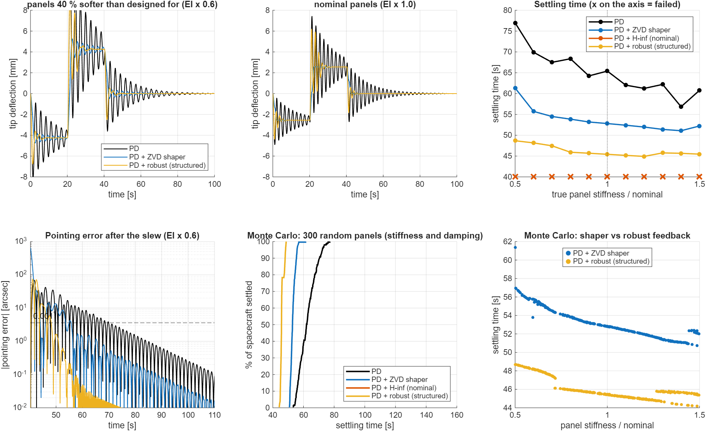
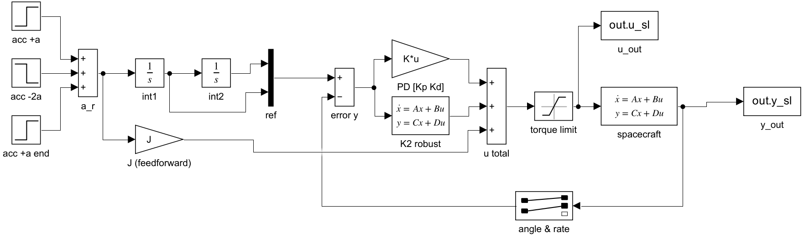
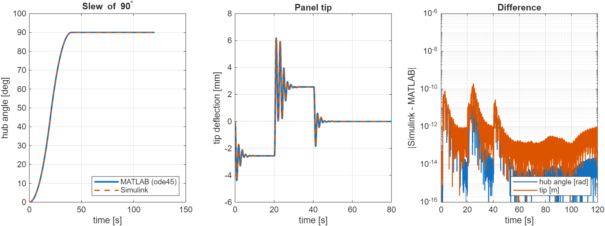

# Project 4 – Spacecraft with flexible solar panels (MATLAB)

A satellite bus carrying two long, light solar panels slews about one axis. The panels
bend, so a fast slew leaves them vibrating, and the controller has to work without
knowing exactly how stiff they are. This is the PhD topic *"Robust control of in-orbit
robotic systems in the presence of unknown flexibilities and parametric uncertainty"*,
in its simplest form.

Everything in this project is MATLAB (Control System and Robust Control Toolboxes) plus a Simulink
cross-check.

*The same 90° slew on a spacecraft whose panels are 40 % softer than the designers assumed
(bending exaggerated 80×): rigid PD, PD with an input shaper tuned to the assumed panels, and PD
with the structured robust H∞ controller of step 4.*

**Summary.** A PD controller designed for a rigid spacecraft leaves the spacecraft settling for 17–37 s
after the slew command ends. Input shaping removes most of it when the panel frequency is known, and degrades as
it is not. An H∞ controller designed for the nominal panels is destabilised by a 2 % stiffness
error. A low-order controller tuned against the whole uncertainty range (structured robust H∞)
damps the panels about 6× more than PD for any stiffness from 0.5× to 1.5×, and settles every one of
300 random spacecraft within 8.4 s of the end of the slew command.

## Plan

1. **Model**: rigid hub + cantilever bending modes (hybrid model), checked against an independent finite-element model. *(done)*
2. **Baseline slew with PD control**: rigid-body design, then measure the panel vibration it causes. *(done)*
3. **Input shaping**: ZV / ZVD command shaping and its sensitivity to errors in the panel frequency. *(done)*
4. **Robust control**: uncertain panel stiffness and damping, H∞ / μ-synthesis / structured robust H∞, worst-case analysis, comparison with steps 2 and 3. *(done)*
5. **Simulink, animation and write-up.** *(done)*

## Step 1 – model

| | |
|---|---|
| hub inertia | 150 kg m² |
| panels | 2 × 3 m, 2 kg/m (6 kg each), root 0.5 m from the axis |
| bending stiffness EI | 82.8 N m² (first cantilever mode 0.40 Hz) |
| whole spacecraft, rigid | J = 207 kg m² (panels are 27.5 %) |
| modal damping | ζ = 0.5 % |

Each panel deflects as $w(x,t)=\sum_i \phi_i(x)\,\eta_i(t)$ with the clamped–free beam modes
$\phi_i$ (normalised so $\rho\int\phi_i^2dx = 1$). A panel element at distance $r+x$ from the
axis moves at $(r+x)\dot\theta+\dot w$, and Lagrange's equations give

$$
J\ddot\theta+\sum_{k=1,2}\delta^T\ddot\eta_k=u,\qquad
\ddot\eta_k+2\zeta\Omega\dot\eta_k+\Omega^2\eta_k+\delta\,\ddot\theta=0,
\qquad \delta_i=\rho\int_0^L (r+x)\,\phi_i(x)\,dx .
$$

**Checks** (`step1_model.m`):

- Cantilever frequencies from $1+\cos\beta L\cosh\beta L=0$ agree with a 40-element
  finite-element beam to 1e-8 – 1e-6.
- The finite-element model of the *free* spacecraft (different coordinates: inertial
  node displacements, no mode shapes) and the hybrid model give the same free
  frequencies; the error of the hybrid model shrinks as modes are added
  (first coupled mode: 9e-5 with 1 mode, 6e-9 with 5).
- One-mode hand formula $\omega=\Omega_1/\sqrt{1-2\delta_1^2/J}$ gives 0.4635 Hz (FE: 0.4634 Hz).
- $\sum_i\delta_i^2\to\rho\int(r+x)^2dx$ (the panel's inertia); the first mode alone carries 92.7 %.
- Torque → hub angle: after removing the 6 states that the torque cannot move,
  the zeros sit at the cantilever frequencies and the poles just above them
  (0.400/0.463 Hz, 2.507/2.531 Hz, 7.019/7.033 Hz) – the pole/zero alternation of a
  collocated actuator and sensor.

Run: `matlab -batch step1_model` in this folder.

## Step 2 – a slew designed for a rigid spacecraft

PD on the hub angle, designed as if the spacecraft were rigid
($K_p=J\omega_n^2$, $K_d=2\zeta J\omega_n$, $f_n=0.05$ Hz, $\zeta=0.7$), plus the rigid feedforward
$u_{ff}=J\ddot\theta_r$. Slew of 90° with |u| ≤ 1 N m (`step2_pd_slew.m`).

| command | slew ends | residual tip vibration | pointing error after slew | settled (0.001° and 1 mm) |
|---|---|---|---|---|
| step, PD only (saturates) | 78 s (38° overshoot) | 1.9 mm | – | 107 s |
| bang-bang + feedforward | 40.3 s | 3.0 mm | 52 arcsec | 65 s |
| quintic + feedforward | 48.4 s | 0.2 mm | 7 arcsec | 57 s |

A rigid model says the two feedforward slews are finished at 40.3 and 48.4 s. On the
flexible spacecraft the panels keep ringing for another 9–25 s, because their own
damping is tiny (ζ = 0.5 %, e-folding time 69 s).

- **Collocated PD is always stable** (actuator and sensor both on the hub; checked for
  bandwidths 0.001–3 Hz), but it damps the panels only weakly: 3.2 % at the design
  bandwidth, at most 14 % at 0.3 Hz. With very high gain the hub is pinned and the
  panel rings at its cantilever frequency with only its structural damping.
- **Residual vibration of a bang-bang slew** (bottom right). Each torque switch starts a
  decaying oscillation; adding the three gives
  $|q| = \frac{F}{\omega^2}\,|1-e^{\lambda T/2}|^2$, nearly zero when $T$ is a whole number of
  *two* vibration periods (every 4.33 s). The hand formula matches the simulation to
  0.11 mm (peak 3.3 mm). This is the idea behind input shaping (step 3).
- **Smooth profiles help**: the quintic (zero acceleration at both ends) leaves ~10× less
  vibration for the same peak torque, at the cost of 8 s longer slews.

Run: `matlab -batch step2_pd_slew` (about 30 s).

## Step 3 – input shaping

Convolve the bang-bang command with a few impulses spaced half a vibration period apart:
the vibration started by one impulse is cancelled by the next (Singer & Seering 1990).
Shapers are tuned to the closed-loop panel mode (0.4623 Hz, ζ = 3.2 %) of step 2
(`input_shaper.m`, `step3_input_shaping.m`).

| shaper | impulses | slew ends | residual tip | settled |
|---|---|---|---|---|
| none | 1 | 40.32 s | 2.95 mm | 65.4 s |
| ZV | 2, over ½ period | 41.40 s | 0.018 mm | 52.3 s |
| ZVD | 3, over 1 period | 42.48 s | 0.015 mm | 52.8 s |
| EI (5 %) | 3, over 1 period | 42.48 s | 0.137 mm | 53.5 s |

At the nominal panel stiffness every shaper removes 95–99.5 % of the vibration for
1–2 s of extra slew time. The remaining ~10 s to settle is the slow (0.05 Hz) PD loop
correcting the hub error the panels caused during the slew, not vibration.

**But the shaper must know the panel frequency.** Sweeping the true stiffness from 0.5× to
1.5× the design value (bottom right, log scale), the range where the residual stays below
0.5 mm is:

| shaper | stiffness range | panel frequency error tolerated |
|---|---|---|
| none | nowhere | – |
| ZV | 0.85 – 1.44 × | −8 % … +20 % |
| ZVD | 0.65 – 1.50 × | −20 % … +23 % |
| EI | 0.55 – 1.50 × | −26 % … +23 % |

The dotted curves are the hand formula: shaped residual = unshaped residual ×
$|\sum_i A_i e^{\lambda(t_n-t_i)}|$ with the *true* panel pole λ. It agrees with the simulation
(median difference 0.014 mm; worst 6 %, at 0.5× stiffness); near the design point the simulated
floor of ~0.02 mm is the 2.5 Hz mode, which the shapers do not target.

Input shaping is open loop: it does nothing against disturbances or unexpected changes and
does not add damping. Step 4 attacks the same uncertainty with feedback.

Run: `matlab -batch step3_input_shaping` (about 30 s; needs `results_step2.mat` from step 2).

## Step 4 – robust feedback for unknown panels

**Uncertainty.** Panel stiffness EI = 0.5 – 1.5 × nominal (panel frequency −29 % … +22 %) and
panel damping 0.4 – 4 × nominal (ζ = 0.2 – 2 %), as `ureal` parameters. Because the cantilever
mode *shapes* do not depend on EI, the stiffness enters exactly as $K = k_{EI}K_0$ (`flex_uss.m`).

**Error coordinates** (`flex_uss_err.m`). Writing $\theta=\theta_r+e$ and $u=J\ddot\theta_r+u_{fb}+d$,
the rigid part of the feedforward cancels and the panels are driven by the commanded
acceleration: $\ddot\eta+C\dot\eta+K\eta+\sqrt2\,\delta\,\ddot e=-\sqrt2\,\delta\,a_r$. This model
reproduces the step 2 simulation to 1 % (5 ms sampling), and it is the input the controller must reject.

**Design.** Keep the PD + feedforward and add a controller $K_2$ on the same measurements (hub
angle and rate errors). Weighted outputs: pointing error and tip deflection (each asked to be
2× smaller than with PD), feedback torque (rolled off above 0.5 Hz). Inputs: slew acceleration,
0.02 N m disturbance, sensor noise. Three ways to compute $K_2$ (`step4_robust.m`):

| design | order | controller itself stable? | robust stability margin | robust performance μ | unstable plants (of 41 EI values) |
|---|---|---|---|---|---|
| PD only | – | – | ≥ 1.5 | 3.24 | 0 |
| (a) H∞ on the **nominal** plant (`hinfsyn`) | 9 | no | **0.04** (2 % error destabilises) | 26 | **38** |
| (b) μ-synthesis (`musyn`, D-G/K) | 143 | no | ≥ 1.5 | 1.47 | 0 |
| (c) **structured robust H∞** (`systune`, 4th order, own poles constrained stable) | 4 | yes | 1.18 | **1.09** | 0 |

(Margin > 1: stable for every plant in the range. μ < 1 would mean every weighted requirement holds
for every plant; 1.09 means they hold to within 9 %.)

- The **nominal H∞ design** is excellent on paper (panel damping 64 %) and useless in practice: a
  2 % stiffness error makes it unstable. Classic lesson: optimise for one plant, get a controller
  fragile to every other.
- **μ-synthesis** is robust but gives a 143-state controller with unstable poles.
- The **structured design** — a 4-state controller tuned directly against the uncertain plant,
  with its own poles constrained to be stable — has the best robust performance of the three.
  The panel damping goes from 2.6 – 4.5 % (PD) to **15 – 30 %** over the whole stiffness range,
  and the worst-case vibration peak drops to 0.25× (PD worst case: 1.42×).

### Step 4b – the controllers on real slews

Full model (both panels, 3 modes each, 1 N m torque limit), the bang-bang 90° slew of step 2,
settling = within 0.001° and 1 mm for good (`step4b_time_domain.m`).

| strategy | settled, EI × 0.5 … 1.5 | Monte Carlo (300 random EI **and** damping): median / 95 % / worst |
|---|---|---|
| PD | 57 – 77 s | 62.0 / 72.3 / 77.1 s |
| PD + ZVD shaper | 51 – 61 s | 52.8 / 55.8 / 61.4 s |
| PD + H∞ (nominal) | **fails everywhere** | 300 / 300 fail |
| PD + robust (structured) | **45 – 49 s** | **45.7 / 48.3 / 48.7 s** |

The slew command itself lasts 40.3 s, so the robust controller settles 5 – 8 s after it, for every
spacecraft sampled; the ZVD shaper needs 11 – 21 s and PD 22 – 37 s.

**Why the nominal H∞ fails even on the nominal plant:** its *linear* closed loop is stable (without a
torque limit it settles to 3e-8°, peaking at 1.3 N m), but the controller itself has unstable poles
(+1.12 1/s). With the real 1 N m limit the torque saturates, the controller's unstable state runs
away and the spacecraft tumbles (−965° after 120 s). The robust controller also touches the limit
(peak 1.00 N m) but is stable itself, so saturation is harmless. Hence the hard constraint on the
controller's own poles in design (c).

Run: `matlab -batch step4_robust` (about 8 min, mostly μ-synthesis) then
`matlab -batch step4b_time_domain` (about 10 min, Monte Carlo on the parallel pool).

## Step 5 – Simulink cross-check and animation

`simulink/build_flex_simulink.m` generates `flex_slew.slx` from a script: Step blocks build the
bang-bang acceleration, two integrators the reference, a Gain the feedforward, and State-Space
blocks the robust controller and the spacecraft, with a Saturation block for the torque limit.
`simulink/run_flex_crosscheck.m` runs it against the MATLAB simulation on the same 6 003 time
samples:

| quantity | max difference |
|---|---|
| hub angle | 2.6e-11 rad (5e-6 arcsec) |
| hub rate | 9.7e-11 rad/s |
| panel tip | 1.9e-10 m (peak 6.2 mm) |
| torque | 7.4e-8 N m (except at the two switching instants, where one tool reports the value just before and the other just after) |

`step5_animate.m` makes the GIF at the top.

## Limitations

- One rotation axis, linear (small-deflection) bending, the panels' in-plane modes ignored.
- The hub angle and rate are measured perfectly apart from white noise (no star-tracker delay or
  gyro bias); actuator is an ideal torque source with a hard limit.
- The structured design reaches robust performance μ = 1.09: the "2× better than PD" targets hold
  to within 9 % for the worst plant, not exactly.
- Uncertainty is only in stiffness and damping; panel mass, hub inertia and the mode-shape coupling
  are taken as known.

## References

- Junkins & Kim, *Introduction to Dynamics and Control of Flexible Structures*, AIAA, 1993 (hybrid
  hub-appendage models).
- Singer & Seering, "Preshaping command inputs to reduce system vibration", *J. Dyn. Sys. Meas.
  Control* 112, 1990; Singhose, Seering & Singer, "Residual vibration reduction using vector diagrams
  to generate shaped inputs", *J. Mech. Design* 116, 1994 (ZV, ZVD, EI shapers).
- Skogestad & Postlethwaite, *Multivariable Feedback Control*, Wiley, 2005 (H∞, μ).
- Apkarian & Noll, "Nonsmooth H∞ synthesis", *IEEE TAC* 51, 2006 (structured H∞, the method behind
  `systune`).

## Files

| file | what it does |
|---|---|
| `flex_params.m` | numbers |
| `flex_model.m` | hybrid model (hub + 3 cantilever modes per panel), state space |
| `flex_fe_model.m` | independent finite-element model, used only for checking |
| `flex_uss.m`, `flex_uss_err.m` | uncertain models (`ureal` stiffness and damping), the second in tracking-error coordinates |
| `slew_profile.m`, `input_shaper.m` | bang-bang / quintic references; ZV, ZVD, EI shapers |
| `flex_simulate.m` | closed-loop simulation with torque limit (ode45, restarted at command switches) |
| `step1_model.m` … `step5_animate.m` | the steps above, in order (each later step loads the previous step's `results_*.mat`) |
| `simulink/` | script-built Simulink model and cross-check |
