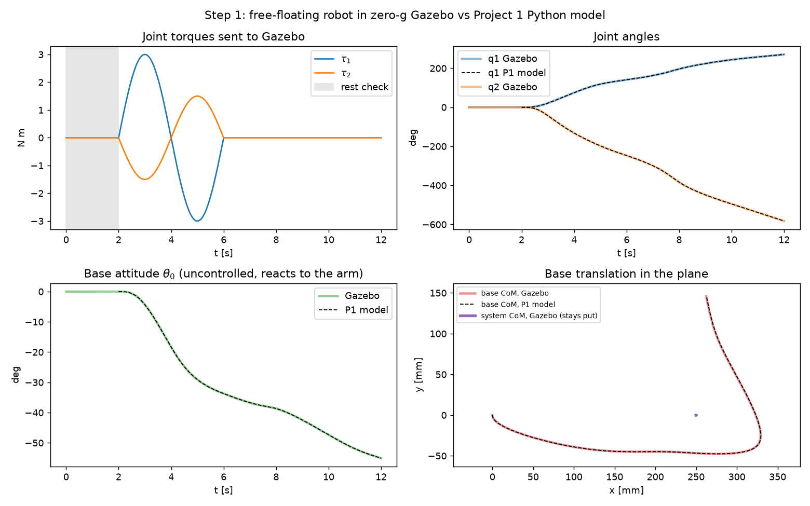
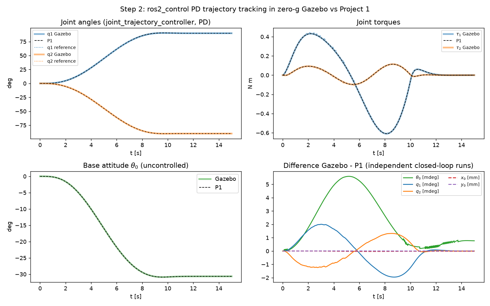

# Project 5 — Free-floating manipulator in ROS 2 + Gazebo (zero-g)

**Status: in progress (steps 1–2 of 5 done).**

Project 1's planar space robot (100 kg base, two 1 m / 10 kg links) rebuilt as a
ROS 2 Jazzy package and simulated in Gazebo Harmonic with gravity switched off.
The arm is torque-controlled through `ros2_control`; the base has no actuators and
is free to react. Every Gazebo result is checked against the independent Python
models from Projects 1 / 1b.

## Layout
- `zero_g_manipulator/` — the ROS 2 package (URDF/xacro, zero-g world, controllers, launch, test nodes)
- `scripts/` — `setup_workspace.sh` (one-time build in `~/ros2_ws`), `run_stepN.sh` (headless runs)
- `stepN_*.py` — Windows-side analysis against the Python models; `figures/`

## Step 1 — the robot in zero-g Gazebo, checked against Project 1
Open-loop test: 2 s with no torque (rest check), then one sine period of joint
torques (3 / −1.5 N m, 4 s), then 6 s of free drift. The torques Gazebo actually
received are replayed in Project 1's Lagrange model.

| check | result |
|---|---|
| URDF mass/inertia/geometry vs P1 params | identical |
| motion with no torque (zero-g) | exactly 0 |
| out-of-plane motion | exactly 0 |
| base angle after the test, Gazebo vs P1 | −55.067° vs −55.063° (max error 0.022°) |
| joint 2 after 583° of rotation | max error 0.12° |
| system CoM drift (must be 0) | 0.34 mm at 1 ms step, 0.17 mm at 0.5 ms → first-order integration error, not physics |



Run it (Ubuntu / WSL):
```bash
bash /mnt/d/Projects/space-robotics/project5_ros2_gazebo/scripts/setup_workspace.sh   # once
bash /mnt/d/Projects/space-robotics/project5_ros2_gazebo/scripts/run_step1.sh
```
then on Windows: `.venv\Scripts\python project5_ros2_gazebo\step1_compare.py`.
To watch it live: `ros2 launch zero_g_manipulator sim.launch.py` (opens the Gazebo window).

## Step 2 — trajectory tracking with the standard ros2_control controller
Project 1's step-3 move, joints (0°, 0°) → (90°, −90°) in 10 s and hold to 15 s, now done by
the stock `joint_trajectory_controller` on the effort interface. Its law is
`tau = Kp (q_ref − q) + Kd (qd_ref − qd)` with P1's gains (Kp = 40/20, Kd = 30/10); the
goal is sent as two waypoints at rest, so its quintic spline is exactly P1's
10x³ − 15x⁴ + 6x⁵ profile. Gazebo (digital PD at 1 kHz) and P1 (continuous PD) are run
**independently** from rest:

| check | result |
|---|---|
| controller reference vs P1 quintic | 4.6e-13° |
| base rotation (uncontrolled) | −30.655° Gazebo vs −30.656° P1 (README P1: −30.7°) |
| base drift | (78.72, −43.79) mm vs (78.73, −43.80) mm |
| max difference over the run | base 0.006°, joints 0.002°, torques 0.012 N m |
| system CoM drift | 0.04 mm |

Detail found on the way: in ~0.2 % of cycles gz_ros2_control runs the controller with
time t + 1 ms while the physics is still at t (visible as a 2 ms gap + a duplicate stamp).
The analysis keeps two time bases (reference ↔ original stamp, measured state ↔ corrected
stamp); the effect on the motion is negligible.



```bash
bash /mnt/d/Projects/space-robotics/project5_ros2_gazebo/scripts/run_step2.sh
```
then `.venv\Scripts\python project5_ros2_gazebo\step2_compare.py`.
