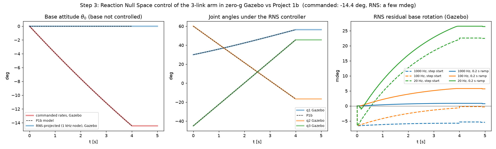
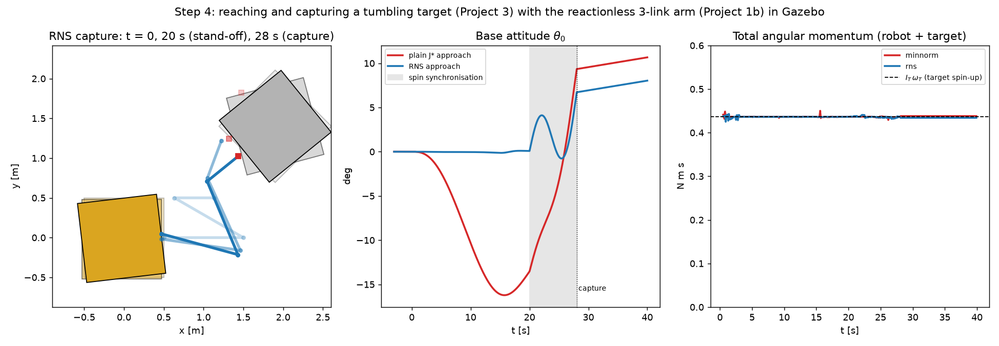

# Project 5 — Free-floating manipulator in ROS 2 + Gazebo (zero-g)

**Status: in progress (steps 1–4 of 5 done).**

Project 1's planar space robot (100 kg base, two 1 m / 10 kg links) rebuilt as a
ROS 2 Jazzy package and simulated in Gazebo Harmonic with gravity switched off.
The arm is torque-controlled through `ros2_control`; the base has no actuators and
is free to react. Every Gazebo result is checked against the independent Python
models from Projects 1 / 1b.

## Layout
- `zero_g_manipulator/` — the ROS 2 package (URDF/xacro, zero-g world, controllers, launch, test nodes)
- `scripts/` — `setup_workspace.sh` (one-time build in `~/ros2_ws`), `run_stepN.sh` (headless runs)
- `stepN_*.py` — Windows-side analysis against the Python models; `figures/`

## Step 1 — the robot in zero-g Gazebo, checked against Project 1
Open-loop test: 2 s with no torque (rest check), then one sine period of joint
torques (3 / −1.5 N m, 4 s), then 6 s of free drift. The torques Gazebo actually
received are replayed in Project 1's Lagrange model.

| check | result |
|---|---|
| URDF mass/inertia/geometry vs P1 params | identical |
| motion with no torque (zero-g) | exactly 0 |
| out-of-plane motion | exactly 0 |
| base angle after the test, Gazebo vs P1 | −55.067° vs −55.063° (max error 0.022°) |
| joint 2 after 583° of rotation | max error 0.12° |
| system CoM drift (must be 0) | 0.34 mm at 1 ms step, 0.17 mm at 0.5 ms → first-order integration error, not physics |


Run it (Ubuntu / WSL):
```bash
bash /mnt/d/Projects/space-robotics/project5_ros2_gazebo/scripts/setup_workspace.sh   # once
bash /mnt/d/Projects/space-robotics/project5_ros2_gazebo/scripts/run_step1.sh
```
then on Windows: `.venv\Scripts\python project5_ros2_gazebo\step1_compare.py`.
To watch it live: `ros2 launch zero_g_manipulator sim.launch.py` (opens the Gazebo window).

## Step 2 — trajectory tracking with the standard ros2_control controller
Project 1's step-3 move, joints (0°, 0°) → (90°, −90°) in 10 s and hold to 15 s, now done by
the stock `joint_trajectory_controller` on the effort interface. Its law is
`tau = Kp (q_ref − q) + Kd (qd_ref − qd)` with P1's gains (Kp = 40/20, Kd = 30/10); the
goal is sent as two waypoints at rest, so its quintic spline is exactly P1's
10x³ − 15x⁴ + 6x⁵ profile. Gazebo (digital PD at 1 kHz) and P1 (continuous PD) are run
**independently** from rest:

| check | result |
|---|---|
| controller reference vs P1 quintic | 4.6e-13° |
| base rotation (uncontrolled) | −30.655° Gazebo vs −30.656° P1 (README P1: −30.7°) |
| base drift | (78.72, −43.79) mm vs (78.73, −43.80) mm |
| max difference over the run | base 0.006°, joints 0.002°, torques 0.012 N m |
| system CoM drift | 0.04 mm |

Detail found on the way: in ~0.2 % of cycles gz_ros2_control runs the controller with
time t + 1 ms while the physics is still at t (visible as a 2 ms gap + a duplicate stamp).
The analysis keeps two time bases (reference ↔ original stamp, measured state ↔ corrected
stamp); the effect on the motion is negligible.


```bash
bash /mnt/d/Projects/space-robotics/project5_ros2_gazebo/scripts/run_step2.sh
```
then `.venv\Scripts\python project5_ros2_gazebo\step2_compare.py`.

## Step 3 — Reaction Null Space controller as a ROS 2 node (3-link arm)
The Project 1b robot (third link 0.5 m / 5 kg, `n_links:=3`) with **joint velocity servos**
(`cmd:=velocity`), the way reactionless control was flown on ETS-VII. A ROS 2 node
(`rns_controller`) reads `/joint_states` and sends `qd = P(q) qd_des` with
`P = I − bᵀb/(b bᵀ)`, where `b(q)` (base angular rate per joint rate) comes from a small
NumPy model inside the node (`free_floating_model.py`; matches P1b's SymPy model to 2e-15).
`b` does not depend on the base pose, so the node needs **no base sensor**.

P1b step-2 case: start (30°, 60°, −45°), `qd_des = (0.2, −0.3, 0.4)` rad/s for 4 s.

| run | base rotation |
|---|---|
| commanded rates, Gazebo / P1b | −14.446° / −14.440° |
| RNS node 1 kHz, Gazebo / P1b | −0.0055° / 0 |
| RNS 1 kHz with 0.2 s velocity ramp | **+0.0007°** (20 000× smaller than commanded) |

Where the last millidegrees come from (`step3_compare.py` splits every run):

| run [mdeg] | Gazebo | = node sample-and-hold | + servo transient | + Gazebo integrator |
|---|---|---|---|---|
| 1 kHz, step start | −5.45 | +1.71 | −6.21 | −0.95 |
| 100 Hz, step start | −0.34 | +6.83 | −6.22 | −0.95 |
| 20 Hz, step start | +22.46 | +29.65 | −6.24 | −0.95 |
| 1 kHz, 0.2 s ramp | +0.74 | +1.64 | +0.005 | −0.91 |
| 100 Hz, 0.2 s ramp | +5.67 | +6.57 | +0.008 | −0.91 |
| 20 Hz, 0.2 s ramp | +26.40 | +28.55 | −1.24 | −0.91 |

- **Sample-and-hold**: `P(q)` is frozen between controller updates while `q` keeps moving;
  the leak grows linearly with the hold time (≈0.57 mdeg per ms here). Computed offline by
  running the node's exact logic on exact kinematics.
- **Servo transient**: a velocity *step* needs more torque than the 200 N m joint limit, so
  the servos take 4–8 ms to reach the command; during that time the joint rates are not in
  the null space and the base gets a kick. A smooth ramp removes it — RNS is a velocity-level
  property, so anything the motors cannot follow leaks into the base.
- **Integrator**: Gazebo's base angle vs `Σ b(q)·Δq` along its own joint path; halves with a
  0.5 ms physics step (first-order integration error, 2e-5 of the commanded rotation).
- The 100 Hz step-start run only *looks* best: its hold leak and servo kick cancel.



```bash
bash /mnt/d/Projects/space-robotics/project5_ros2_gazebo/scripts/run_step3.sh     # 7 runs, ~2.5 min
```
then `.venv\Scripts\python project5_ros2_gazebo\step3_compare.py`.

## Step 4 — reach and capture a tumbling target (Project 3 + Project 1b)
Project 3's debris — a 50 kg, 1 m plate with a handle 0.6 m from its centre, spinning at
3°/s — is now a free body in Gazebo (`worlds/zero_g_target.sdf`, its own odometry). The
`capture_controller` node:
1. releases the initial weld (`DetachableJoint` starts attached), spins the target up with a
   single 1-ms torque (`ApplyLinkWrench`; measured spin 3.0000°/s),
2. **phase A (0–20 s)**: brings the gripper to a point 10 cm in front of the moving handle
   with the P1b reactionless law (`rns`) or plain generalized-Jacobian control (`minnorm`),
3. **phase B (20–28 s)**: final approach while the gripper is turned to point into the handle
   and **spin-synchronised** with the target (`[J*; b+1] q̇ = [v; φ̇]`),
4. at 28 s welds the gripper to the handle (`DetachableJoint` attach) and locks the joints.

The start pose (0°, 150°, −150°) was chosen offline (`step4_plan.py`, 1728 poses, 11 processes)
for the smallest total base rotation with margins from both singularities.

| | RNS approach | plain J* approach |
|---|---|---|
| base rotation during approach (0–20 s) | **0.135°** max | 16.2° max |
| base rotation in the spin-synchronised final approach | +6.6° | −13.5° → +9.3° |
| gripper–handle at capture | 0.07 mm, 0.002° | 0.08 mm, 0.010° |
| total angular momentum across capture | 0.4363 → 0.4341 N m s (0.5 %) | 0.3 % |
| composite spin after capture: Gazebo / `L_cm / I_sys` | 0.10963 / 0.10963°/s | 0.11041 / 0.11041°/s |

**Why phase B exists — Gazebo's weld is kinematic.** The first version captured with the
gripper on the handle but *not* turning with it. Total angular momentum then jumped from
0.436 to −9.9 N m s at the weld. Gazebo's DART back end implements the attach as
`moveTo<WeldJoint>`: the target is re-parented under the gripper link and simply **adopts its
velocity**, the target's own motion is discarded (no impact law). The jump matched exactly:
the target took the gripper's −4.4°/s instead of +3°/s, giving its centre 0.13 rad/s × 0.6 m
= 0.078 m/s (measured 0.0784 m/s). A soft capture therefore needs zero relative *twist* —
which is also what a real gripper needs. With three joints that uses the arm's only spare
degree of freedom, so the base cannot be held still at the same time: **reactionless
approach and spin-matched capture compete for the same redundancy**. The remaining base
rotation is what a 4th joint or a reaction wheel (Project 3 step 4) would have to absorb.

After capture the joints are locked and robot + target spin as one rigid body: 3°/s of
debris becomes 0.11°/s of the whole stack (Project 3 with the 2-link arm: 0.12°/s).



```bash
bash /mnt/d/Projects/space-robotics/project5_ros2_gazebo/scripts/run_step4.sh       # rns + minnorm, ~2 min
```
then `.venv\Scripts\python project5_ros2_gazebo\step4_plan.py` (start-pose search, ~1 min) and
`.venv\Scripts\python project5_ros2_gazebo\step4_compare.py`.
