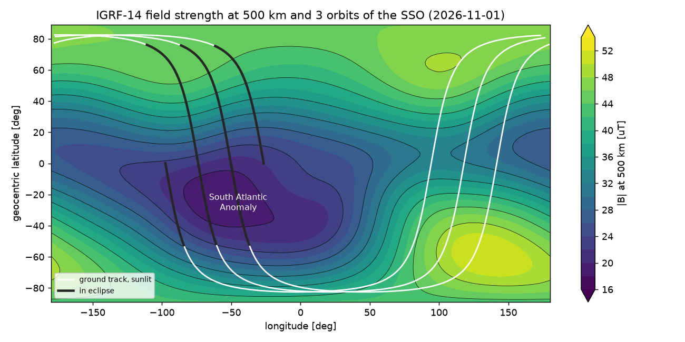
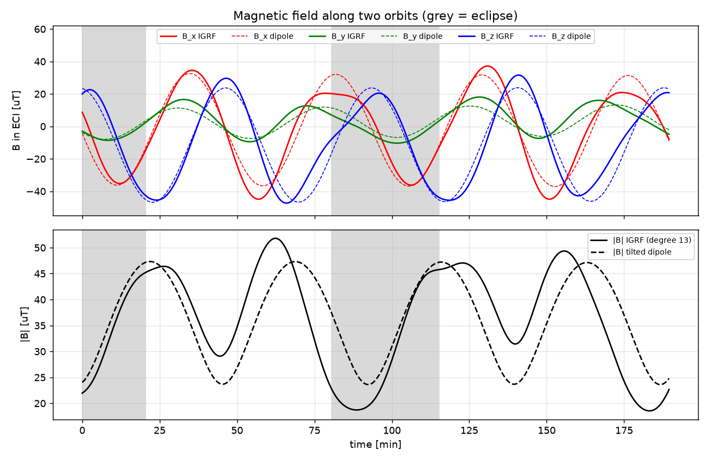
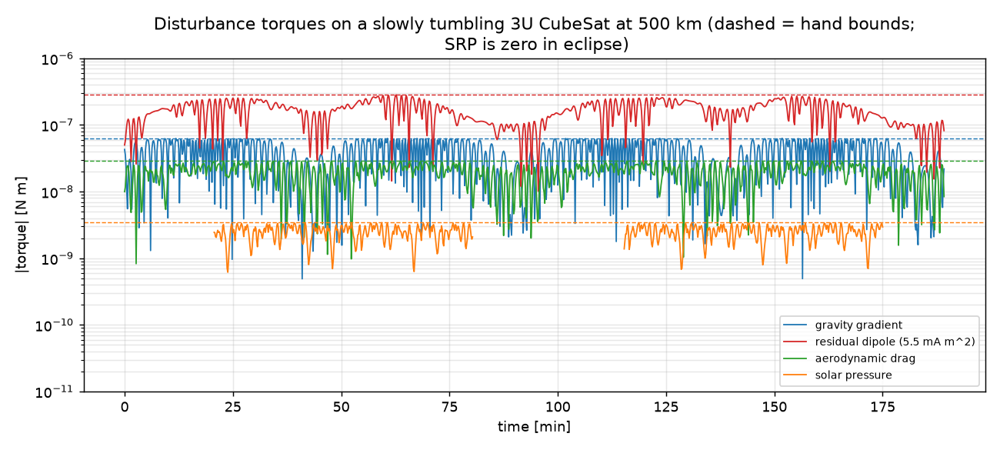
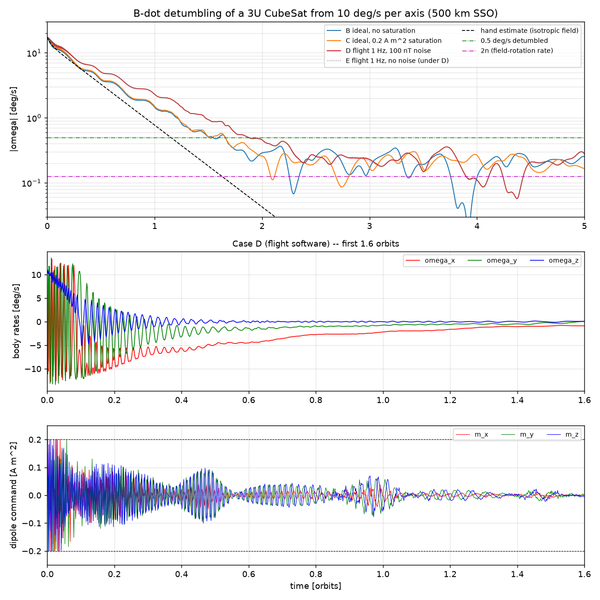
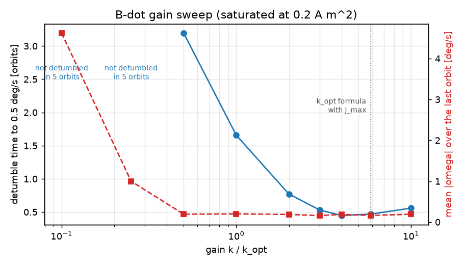

# Project 6 — CubeSat ADCS (attitude determination and control)

A 3U CubeSat (4 kg) in a 500 km sun-synchronous orbit: environment and disturbances,
B-dot detumbling, attitude determination (TRIAD, MEKF), reaction-wheel pointing with
magnetic momentum unloading, Monte Carlo pointing budget. Python (NumPy/SciPy, IGRF-14 via `ppigrf`).

| file | content |
|---|---|
| `params.py` | mass properties, surfaces, residual dipole, actuator limits |
| `orbit.py` | two-body + J2 propagation, SSO design (i = 97.40 deg, LTAN 10:30) |
| `environment.py` | IGRF-14 / tilted-dipole field, Sun + shadow, density, disturbance torques, pre-computed `OrbitEnvironment` |
| `attitude.py` | Euler parameters, DCMs, rigid-body equations (Schaub & Junkins conventions) |

## Step 1 — orbit, environment and disturbance torques

`python step1_environment.py` (~30 s). Checks:

- **SSO:** J2 nodal drift of the propagated orbit 0.990 deg/day vs analytic 0.9856 (= Sun's mean motion); the 0.5 % gap is osculating-vs-mean elements.
- **Sun model** vs JPL Horizons apparent RA/Dec on 4 dates: 5–12 arcsec.
- **Eclipse** (beta = 23.6 deg): 34.8 min propagated vs 34.6 min analytic.
- **Field:** own tilted-dipole formula vs ppigrf truncated at degree 1: 1e-15 T (frames and signs right; the IGRF reference radius is 6371.2 km, not 6378.137). Full IGRF differs from the dipole by up to 16 uT / 34 deg in direction — matters for magnetometer-based estimation.
- **Torques:** for a convex symmetric box the face-by-face drag/SRP torque equals (-r_CM) x F_total to 1e-23 N m; peak torques reach the hand bounds.
- **Dynamics:** torque-free |H| conserved to 1e-13 N m s; with disturbances H_N(t) - H_N(0) = integral of the inertial torque to 4e-12.

Disturbance ranking at 500 km: residual dipole (2.8e-7 N m) > gravity gradient (6.3e-8) > drag (2.9e-8) > SRP (3.4e-9).
A few mA m^2 of residual dipole dominate — magnetic cleanliness is the first ADCS requirement for a CubeSat.

## Step 2 — B-dot detumbling

`bdot.py`, `python step2_bdot.py` (~4 min on 12 cores). Law m = -(k/|B|) b_dot (b = field direction in the body),
so tau = m x B = -k (I - b b^T) omega: only the rate component perpendicular to B is damped.
Gain k_opt = 2n(1 + sin xi_m) J_min = 3.1e-5 N m s (Avanzini & Giulietti 2012; xi_m = 80 deg).
Start: 10 deg/s on every axis. Detumbled = |omega| stays below 0.5 deg/s.

- **Energy check** (no disturbances): T(t) - T(0) = integral of omega . tau_mtq to 3e-13 J; T decreases monotonically.
- **Detumble time:** hand estimate (isotropic field direction) 1.15 orbits; ideal law 1.66 orbits (1.50 without disturbances);
  flight software (1 Hz magnetometer with 100 nT noise, finite-difference b_dot, coils on 80 % of each second) 1.87 orbits.
- **Residual rate** ~0.13–0.2 deg/s: B-dot only follows the field direction, which turns at about 2n = 0.127 deg/s on a
  polar orbit; disturbances (mainly the residual dipole) keep it slightly above that. Pointing control has to take over from here.
- **Gain sweep:** for this elongated 3U (J_max/J_min = 5.9) the J_min formula is conservative: 3–6 k_opt detumbles in
  about 0.5 orbit (vs 1.66). The slowest mode is rotation about the long-inertia axes, damped at a rate of about k/J_max. Too low a gain
  (≤ 0.25 k_opt) does not detumble in 5 orbits; above 4 k_opt it gets slower again.
- Magnetometer noise of 100 nT barely matters: the noise it adds to the dipole has zero mean and averages out.

