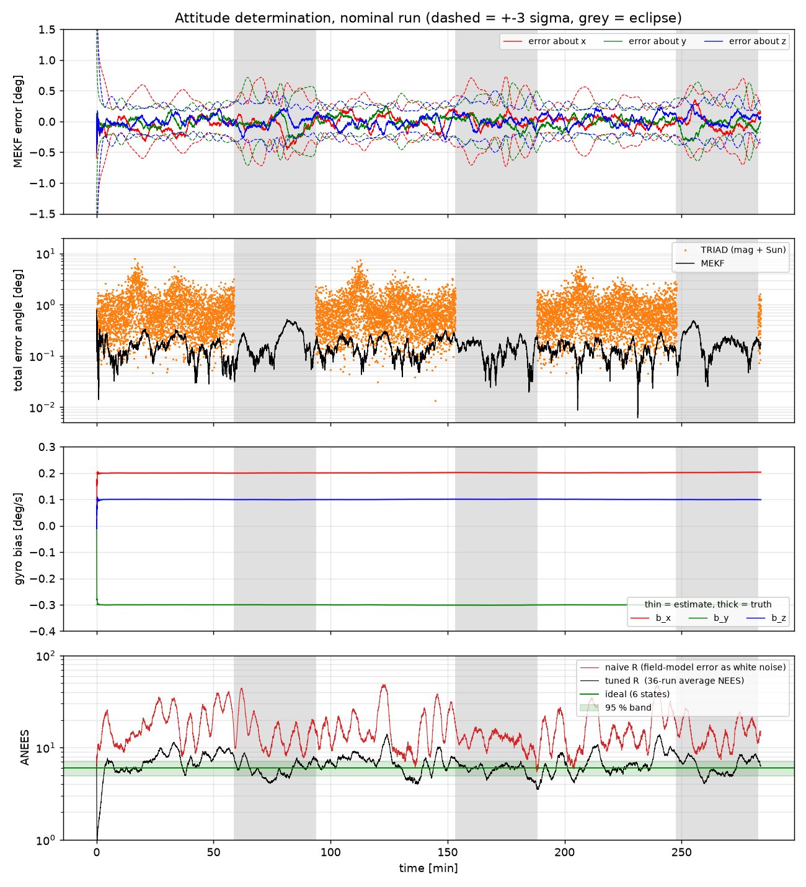
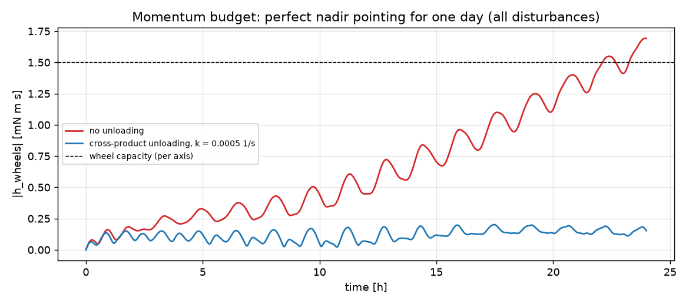
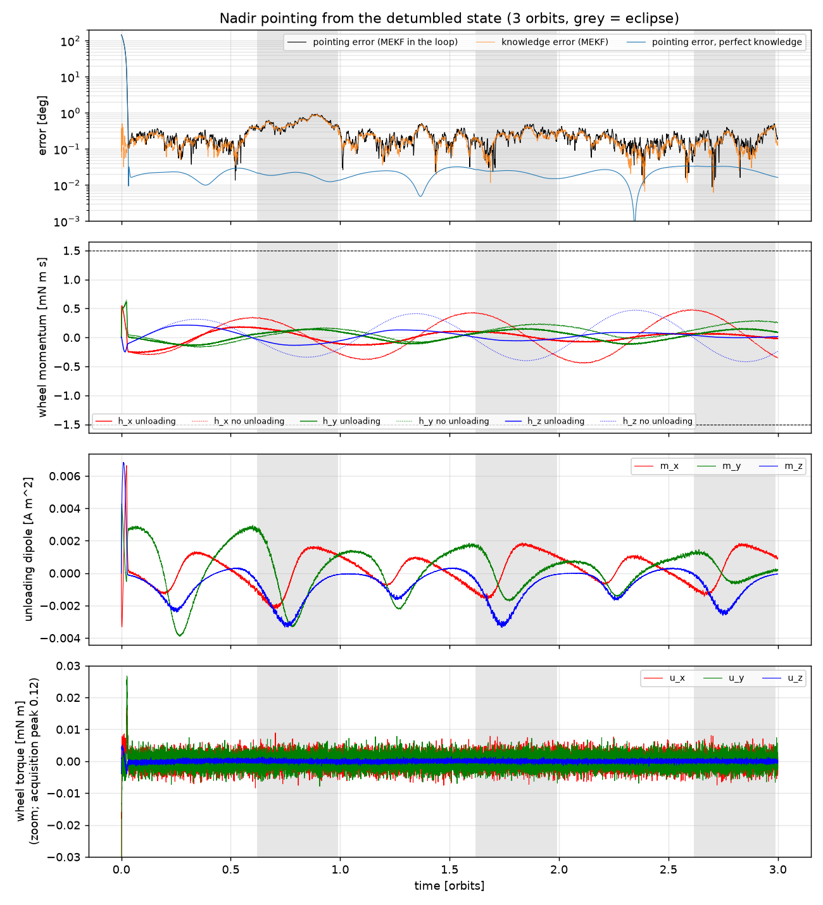
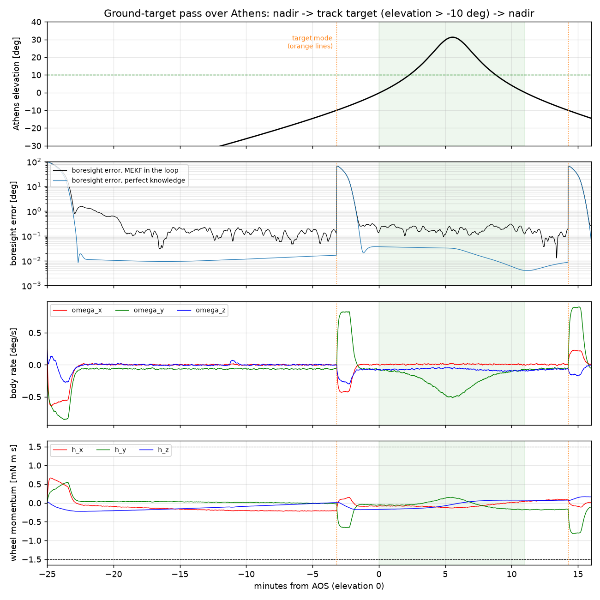
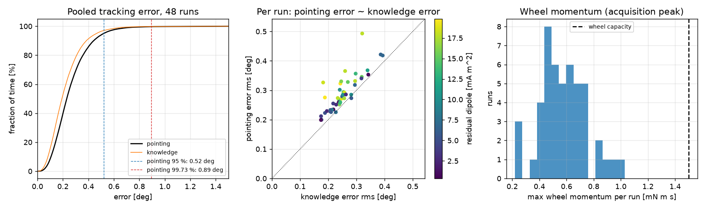

# Project 6 — CubeSat ADCS (attitude determination and control)

A 3U CubeSat (4 kg) in a 500 km sun-synchronous orbit: environment and disturbances,
B-dot detumbling, attitude determination (TRIAD, MEKF), reaction-wheel pointing with
magnetic momentum unloading, Monte Carlo pointing budget. Python (NumPy/SciPy, IGRF-14 via `ppigrf`).

| file | content |
|---|---|
| `params.py` | mass properties, surfaces, residual dipole, actuator limits |
| `orbit.py` | two-body + J2 propagation, SSO design (i = 97.40 deg, LTAN 10:30) |
| `environment.py` | IGRF-14 / tilted-dipole field, Sun + shadow, density, disturbance torques, pre-computed `OrbitEnvironment` |
| `attitude.py` | Euler parameters, DCMs, rigid-body equations (Schaub & Junkins conventions) |
| `bdot.py` | B-dot detumbling law, continuous and 1 Hz flight-software simulators |
| `sensors.py` | magnetometer, coarse sun sensors, MEMS gyro (Farrenkopf model) |
| `estimation.py` | TRIAD and multiplicative EKF with gyro-bias estimation |
| `controller.py` | nadir / ground-target reference, rate-limited PD wheel law, cross-product unloading |
| `closed_loop.py` | full loop: truth (RK4) -> sensors -> MEKF -> control -> wheels + coils, 1 Hz cycle |

## Step 1 — orbit, environment and disturbance torques

`python step1_environment.py` (~30 s). Checks:

- **SSO:** J2 nodal drift of the propagated orbit 0.990 deg/day vs analytic 0.9856 (= Sun's mean motion); the 0.5 % gap is osculating-vs-mean elements.
- **Sun model** vs JPL Horizons apparent RA/Dec on 4 dates: 5–12 arcsec.
- **Eclipse** (beta = 23.6 deg): 34.8 min propagated vs 34.6 min analytic.
- **Field:** own tilted-dipole formula vs ppigrf truncated at degree 1: 1e-15 T (frames and signs right; the IGRF reference radius is 6371.2 km, not 6378.137). Full IGRF differs from the dipole by up to 16 uT / 34 deg in direction — matters for magnetometer-based estimation.
- **Torques:** for a convex symmetric box the face-by-face drag/SRP torque equals (-r_CM) x F_total to 1e-23 N m; peak torques reach the hand bounds.
- **Dynamics:** torque-free |H| conserved to 1e-13 N m s; with disturbances H_N(t) - H_N(0) = integral of the inertial torque to 4e-12.

Disturbance ranking at 500 km: residual dipole (2.8e-7 N m) > gravity gradient (6.3e-8) > drag (2.9e-8) > SRP (3.4e-9).
A few mA m^2 of residual dipole dominate — magnetic cleanliness is the first ADCS requirement for a CubeSat.

## Step 2 — B-dot detumbling

`bdot.py`, `python step2_bdot.py` (~4 min on 12 cores). Law m = -(k/|B|) b_dot (b = field direction in the body),
so tau = m x B = -k (I - b b^T) omega: only the rate component perpendicular to B is damped.
Gain k_opt = 2n(1 + sin xi_m) J_min = 3.1e-5 N m s (Avanzini & Giulietti 2012; xi_m = 80 deg).
Start: 10 deg/s on every axis. Detumbled = |omega| stays below 0.5 deg/s.

- **Energy check** (no disturbances): T(t) - T(0) = integral of omega . tau_mtq to 3e-13 J; T decreases monotonically.
- **Detumble time:** hand estimate (isotropic field direction) 1.15 orbits; ideal law 1.66 orbits (1.50 without disturbances);
  flight software (1 Hz magnetometer with 100 nT noise, finite-difference b_dot, coils on 80 % of each second) 1.87 orbits.
- **Residual rate** ~0.13–0.2 deg/s: B-dot only follows the field direction, which turns at about 2n = 0.127 deg/s on a
  polar orbit; disturbances (mainly the residual dipole) keep it slightly above that. Pointing control has to take over from here.
- **Gain sweep:** for this elongated 3U (J_max/J_min = 5.9) the J_min formula is conservative: 3–6 k_opt detumbles in
  about 0.5 orbit (vs 1.66). The slowest mode is rotation about the long-inertia axes, damped at a rate of about k/J_max. Too low a gain
  (≤ 0.25 k_opt) does not detumble in 5 orbits; above 4 k_opt it gets slower again.
- Magnetometer noise of 100 nT barely matters: the noise it adds to the dipole has zero mean and averages out.

## Step 3 — sensors and attitude determination (TRIAD, MEKF)

`sensors.py`, `estimation.py`, `python step3_estimation.py` (~6 min on 12 cores).
Truth: the detumbled CubeSat (0.3–0.6 deg/s, disturbances on) for 3 orbits.
Sensors: gyro at 10 Hz (ARW 0.3 deg/sqrt(h), turn-on bias up to 0.3 deg/s); magnetometer (100 nT) and 6 coarse sun sensors (1 %) at 1 Hz.
The onboard field model is IGRF truncated at degree 8 (42.6 nT rms error vs the degree-13 truth).

- **TRIAD** (magnetometer as the primary vector): 1.1 deg rms, only in sunlight (37 % of the orbit is eclipse).
- **MEKF** (multiplicative EKF, error state = 3 small angles + 3 gyro-bias errors):
  - attitude error 0.16 deg rms in sunlight, 0.21 deg in eclipse (magnetometer + gyro only)
  - gyro bias learned to 5e-4 deg/s within minutes
  - 99.9 % of the errors inside +-3 sigma
- **Consistency (36-run Monte Carlo, average NEES of the 6 error states; ideal value 6):** feeding the field-model
  error to the filter as white noise gives ANEES = 16.6, i.e. the filter is over-confident. The model error is correlated
  over minutes (degree 9–13 terms have wavelengths of ~3000 km, about 400 s of flight), so a white-noise R must be inflated by
  roughly the square root of the number of correlated samples. With the model-error term inflated 10x and the
  CSS noise at 0.03 rad, ANEES is 6.8 (eclipse 6.0, sunlit 7.3) at the same 0.2 deg accuracy. The small remaining excess
  in sunlight comes from correlated errors that a white-noise R cannot fully represent (fix: full-degree onboard model, or
  consider-states).

## Step 4 — reaction-wheel pointing and magnetic momentum unloading (full loop)

`controller.py`, `closed_loop.py`, `python step4_pointing.py` (~5 min on 12 cores).
Full loop at 1 Hz: truth (RK4, 0.1 s) -> gyro / magnetometer / sun sensors -> MEKF -> guidance -> wheels + coils.
Magnetometer readings are taken while the coils are off; the coils are on for 0.8 s of each 1 s cycle.

- **Attitude law:** rate-limited PD with feedforward. w_des = w_r + sat(-k 2 eps, 1 deg/s), and
  u = J(w_r' - w x w_r) + w x (J w + h_w) - P (w - w_des) - tau_mtq.
  Bandwidth 0.1 rad/s, zeta 0.9. The 1 deg/s slew limit keeps J w < 1.5 mN m s, the wheel capacity.
- **Unloading:** m = (k/|B|^2)(h_w x B), so tau = -k (I - b b^T) h_w.
- **Momentum budget** (perfect nadir tracking, 1 day): without unloading |h_w| grows to 1.7 mN m s,
  mostly from drag on the CoM offset and gravity gradient on the products of inertia.
  With unloading it stays below 0.2 mN m s.
- **Nadir pointing from the detumbled state** (3 orbits): acquired in 165 s.
  - Pointing error with perfect knowledge (control error only): 0.023 deg rms.
  - With the MEKF in the loop: 0.30 deg rms, 0.84 deg at the 99th percentile. Knowledge error is 0.28 deg, so
    attitude knowledge, not control, limits the pointing.
  - Wheel momentum at the end: 0.09 mN m s with unloading vs 0.50 mN m s without.
  - Inertial momentum check (wheels are internal): 1e-16 N m s.
- **Athens target pass** (daylight, max elevation 31 deg): the slew starts at elevation -10 deg and is 66 deg long;
  the boresight is within 1 deg 89 s later.
  - For elevation > 10 deg the boresight error is 0.18 deg rms (0.03 deg with perfect knowledge).
  - Peak body rate 0.97 deg/s; wheel momentum stays below 0.82 mN m s.

## Step 5 — Monte Carlo pointing budget and animation

`python step5_montecarlo.py 48` (~13 min on 12 cores, streams to `results_step5_mc.jsonl`), then `python step5_analysis.py`.
Each run disperses the truth while the flight software keeps the nominal model:
- inertia ±10 %, products of inertia ±0.5e-3 kg m^2
- CoM offset 1 cm per axis (1 sigma), residual dipole 0–20 mA m^2 in a random direction
- gyro bias 0.3 deg/s (1 sigma)
- random initial attitude, rate up to 0.5 deg/s, start time anywhere in the first day

Each run then flies one orbit of nadir pointing with the full loop.

- **Acquisition** (error below 1 deg for 5 min): median 178 s, worst 942 s.
- **Tracking error, pooled over 48 runs (69 h of flight):**

  | percentile | pointing | knowledge |
  |---|---|---|
  | 50 % | 0.23 deg | 0.19 deg |
  | 95 % | 0.52 deg | 0.46 deg |
  | 99 % | 0.70 deg | 0.64 deg |
  | 99.73 % | 0.89 deg | 0.81 deg |

  The pointing error is 0.26 deg rms in sunlight and 0.35 deg in eclipse. It is above 1 deg for 0.2 % of the time,
  in 3 of 48 runs, all in eclipse with a large residual dipole; the worst instantaneous error is 1.5 deg.
- **What drives it:** per-run pointing error correlates +0.83 with knowledge error and +0.37 with the residual dipole.
  The PD law has no integral action, so a constant dipole torque leaves a steady offset. The next improvements would be
  in-flight dipole calibration (or an integral term) and a better onboard field model (step 3).
- **Margins:** wheel momentum at most 1.03 of 1.5 mN m s (during acquisition); wheel torque at most 0.19 of 0.5 mN m;
  unloading dipole at most 0.014 of 0.2 A m^2. The momentum check holds to 7e-16 N m s in every run.

`python step5_animate.py` (after step 4): the Athens pass. Left: the CubeSat in the orbit frame (red = camera face).
Right: where the boresight hits the ground, with a ±10 km zoom on Athens.

## Summary

| | result |
|---|---|
| detumbling 10 deg/s per axis | 1.9 orbits (flight B-dot, 1 Hz, 80 % duty) |
| attitude knowledge (MEKF, mag + CSS + MEMS gyro) | 0.2–0.3 deg rms, consistent after R tuning (ANEES 6.8) |
| pointing, 99.73 % (48-run Monte Carlo) | 0.89 deg, knowledge-limited |
| ground-target tracking (Athens, 31 deg pass) | 0.18 deg rms boresight error, ~3 km on the ground |
| momentum management | unloading keeps the wheels below 0.2 mN m s per day of nadir pointing |
