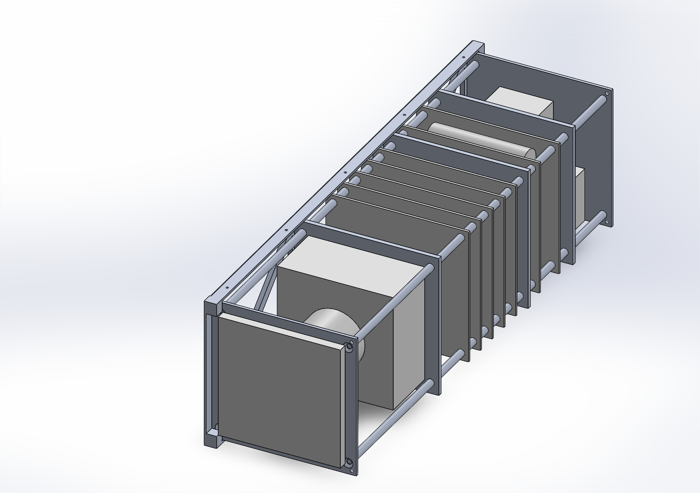
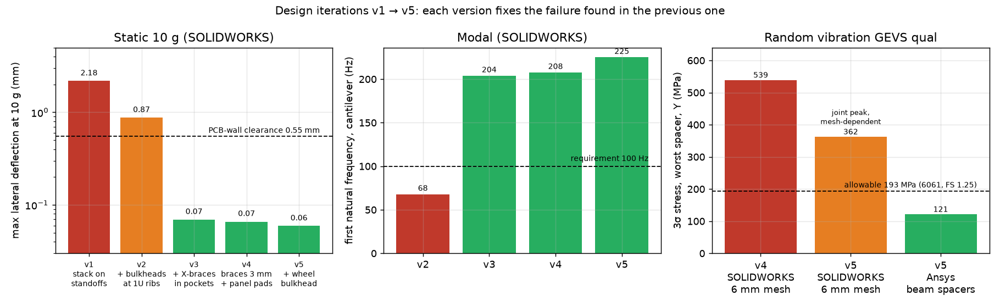
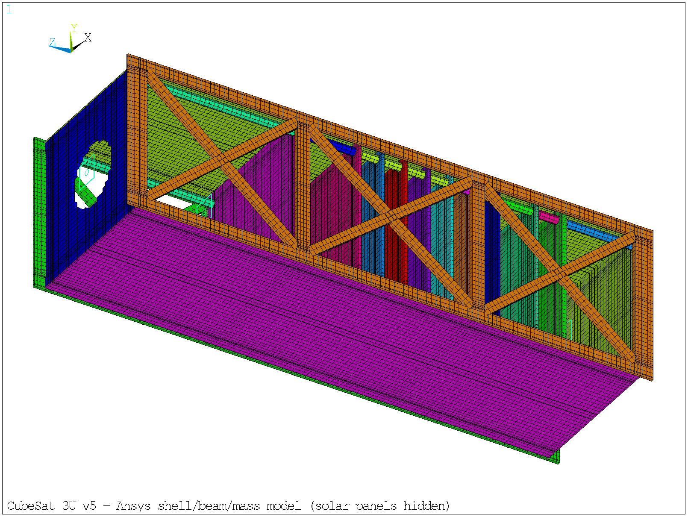
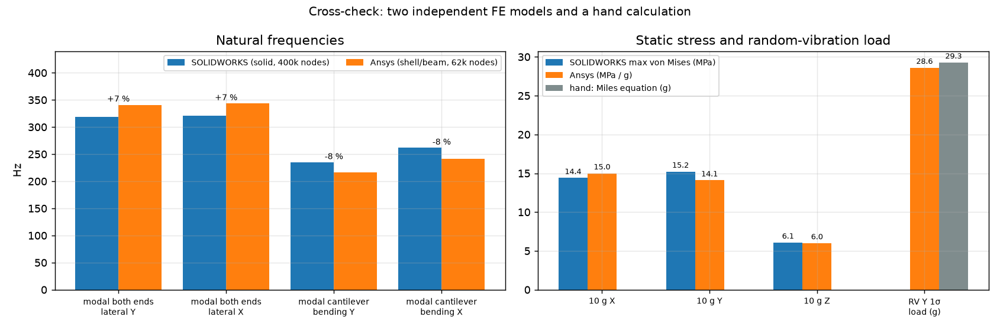
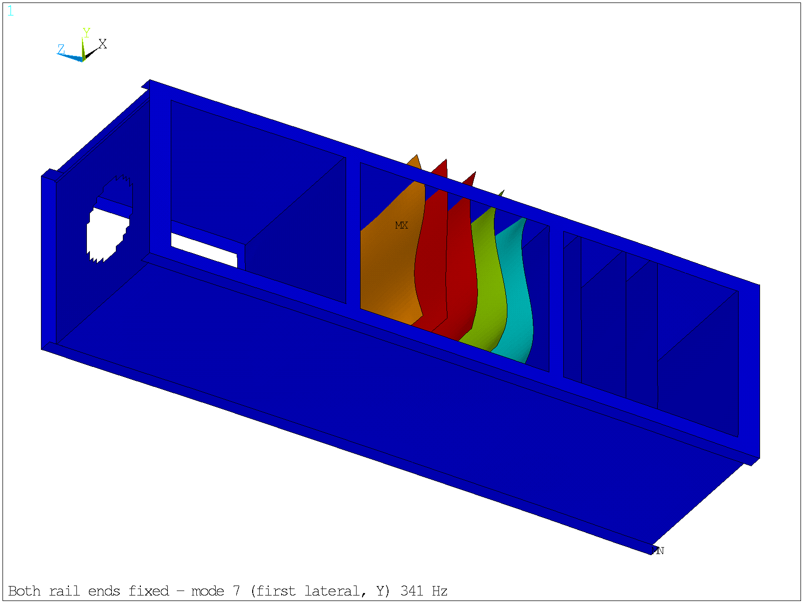
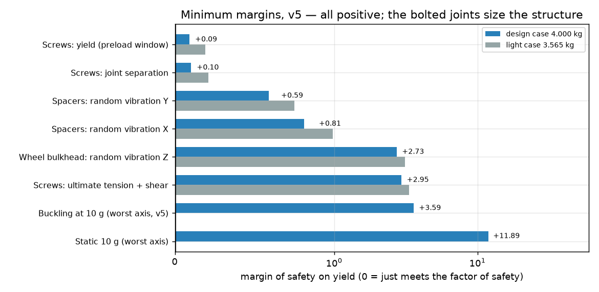
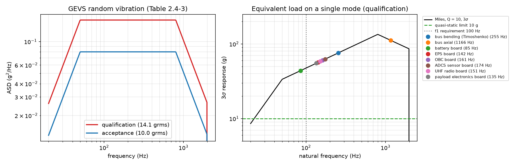

# Project 7: 3U CubeSat structure — FEA, design iteration and margins

Structural design and analysis of the 3U CubeSat from [Project 6](../project6_cubesat_adcs/)
(4.000 kg, 100 × 100 × 340.5 mm) against the launch environment: quasi-static loads, natural
frequency, buckling, NASA GEVS qualification random vibration and the bolted joints.
The structure went through **five design iterations** — each analysis found a real weakness and the next version
fixed it — and the final design was **cross-checked with a second, independently built FE model in Ansys MAPDL**
and with hand calculations.



**Result (design v5): every requirement is met with positive margin.**

| Requirement (source) | Result, v5 | Margin |
|---|---|---|
| First natural frequency > 100 Hz (typical launcher / deployer) | 225 Hz (cantilever fixture) | f1 = 2.25 × requirement |
| 10 g quasi-static, FS 1.25 yield / 1.4 ultimate (NASA-STD-5001B) | 15 MPa max | > +11 |
| No buckling at the 3σ random-vibration load × 1.4 | load factor ≥ 48.7 at 10 g, solar panels removed (needs ≥ 10.6 lateral / 15.7 axial) | +3.6 |
| GEVS qualification random vibration, 14.1 g rms, 3 axes (GSFC-STD-7000B) | worst 3σ stress 121 MPa (spacers) | +0.59 yield / +0.71 ult |
| M3 bolted joints: separation, yield, ultimate (NASA-STD-5020A) | worst bolt load 623 N | +0.10 / +0.09 / +2.95 |

The full table with every load case and its independent check is in
[`results/margins_summary.md`](results/margins_summary.md).

## What is in this project

| Step | Content | Tool |
|---|---|---|
| 0 | Solver benchmark: cantilever bar vs beam theory (modal + random vibration) | SOLIDWORKS Simulation |
| 1 | Hand calculations: mass budget, 10 g, beam/plate frequencies, Miles' equation, rail buckling | Python |
| 2 | CAD: side frames with rails, shear panels, end plates, bulkheads, PCB stack, mass dummies; v1 → v5 | SOLIDWORKS (C# API) |
| 3 | 10 g quasi-static, 3 axes, mesh convergence | SOLIDWORKS Simulation |
| 4 | Modal + effective mass (cantilever fixture and both rail ends fixed) | SOLIDWORKS Simulation |
| B | Linear buckling at 10 g, 3 axes, with and without the solar panels | SOLIDWORKS Simulation |
| 5 | Random vibration, GEVS qualification, 3 axes | SOLIDWORKS → Ansys MAPDL |
| A | Independent shell/beam/mass model: modal, static, PSD, bolt loads, light case | Ansys MAPDL 2022 R2 |
| 6 | Margins table, figures | Python |

Everything is scripted. SOLIDWORKS is driven from C# through its API (`sw/*.cs`, run by `sw/run.ps1`); the Ansys
model is generated by Python from the same component list that builds the CAD; every number in this README is
read from a result file in `results/`.

## The satellite

- **4.000 kg design mass.** Real structure (≈ 0.76 kg: side frames, shear panels, end plates, bulkheads, spacers) plus
  equipment from the Project 6 budget (7 boards, battery cells, two reaction wheels, camera, antenna, 4 solar panels),
  scaled up by a common **mass margin** so the total is 4.000 kg. Without the margin the satellite is 3.565 kg
  (the *light case*, also analysed).
- **Structure:** two machined 7075-T6 side frames that carry the four CubeSat rails, two 1 mm 6061-T6 shear panels,
  2 mm end plates, and 3 mm 6061-T6 bulkheads. The boards are stacked on 5 mm 6061 spacers (PC/104 hole pattern)
  with M3 screws.
- **Fixture cases:** *cantilever* (rail ends at Z = 0 fixed; the vibration-table case, used for modal and 10 g) and
  *both rail ends fixed* (the deployer case, used for random vibration).

## Design history: v1 → v5



| Version | Change | What the analysis found | Lesson |
|---|---|---|---|
| v1 | Board stack on long spacers, held only at the end plates | 10 g lateral: stack bows 2.18 mm but the boards are only 0.55 mm from the walls → contact; 201 MPa | Long equipment stacks need lateral support stations |
| v2 | 3 mm bulkheads at the 1U and 2U ribs, tied to the frame | stack deflection 0.06 mm; but f1 = **68 Hz** (< 100 Hz): the solar panels flap over the open side-frame pockets, and the pocketed frames are weak shear webs | Panels must land on solid structure; pocketed shear webs need bracing |
| v3 | X-braces (6 × 1.5 mm) in all side-frame pockets, longer solar panels | f1 = 204 Hz; buckling passes only because the bonded solar panels stiffen the braces (load factor 5.7 without them) | Never take credit for non-structural parts in a stability check |
| v4 | Braces 3 mm thick, 1.5 mm solar-panel pads | f1 = 208 Hz, buckling ≥ 32 without panels, 10 g margins > +5; **random vibration fails** at the root of the spacers that carry the reaction-wheel plate (3σ 539 MPa vs 193 MPa allowable) | Heavy units (wheels) must mount to the frame, not hang on spacers |
| v5 | Wheel plate becomes a full-width bulkhead tied to the side frames | f1 = 225 Hz, buckling ≥ 48.7 (v4 32), 10 g 15 MPa; random vibration and bolts pass | — |

The total mass is 4.000 kg in every version: when structure was added, the equipment margin was reduced by the same
amount (margin factor 1.273 → 1.240 → 1.226 → 1.203 → 1.202), so the versions compare like for like.

## Random vibration and the second FE model

GEVS qualification: 20 Hz 0.026 g²/Hz → 50–800 Hz 0.16 g²/Hz → 2000 Hz 0.026 g²/Hz = 14.1 g rms, 5 % modal damping
(Q = 10). The design stress is the 3σ value, 3 × the RMS stress.

**Why a second model.** In the SOLIDWORKS solid model of v5 the peak RMS stress sits exactly where a 5 mm spacer is
bonded to a plate, a sharp re-entrant corner. Refining the mesh there moved the answer from 121 to 125 to 32 MPa
RMS (6 / 4 / 3 mm). A stress at a bonded corner between two solids has no converged value, so it cannot carry a
margin. Industry practice for equipment stacks is not to resolve that corner but to idealise the structure:
spacers as **beams** (their bending moment gives the stress, M/Z, with no singularity), plates as **shells**,
units as **point masses with inertia**, and the bolted joints checked separately from the beam end forces
(NASA-STD-5020A). That is what the Ansys model does.

**The Ansys model** (`ansys/build_model.py` → `ansys/model.inp`) is the *same* design, generated from the component
list (`cad/interior_spec.txt`) that also built the CAD — not a simplified one.
SHELL181 mid-surfaces (side frames + rail flanges, shear panels, end plates, bulkheads, PCBs, solar panels),
BEAM188 X-braces and spacers at their real lengths, MASS21 wheels / battery cells / camera / antenna, rigid links for
the bonded joints. Each part's density is scaled so its mass matches the CAD (corrections within 1.5 %), giving
**4000.00 g with the centre of mass identical to the CAD**. 61.8k nodes, so it also runs in Ansys Student.



**Correlation** between two independently built models and a hand calculation:



- Frequencies agree within 8 %. Ansys is 7 % stiffer for the stack modes (rigid links are stiffer than bonded solid
  contact) and 8 % softer for global bending (shells omit the solid rail feet and pocket fillets); the direction of
  each difference is understood.
- 10 g static stresses agree within 10 % and peak at the same place (13 mm spacer above the 1U rib); the reactions sum
  to 392.26 N = m × 10 g in both models.
- **Miles' equation** on the governing mode (stack sway, 341 Hz, Q = 10, 0.16 g²/Hz) predicts 29.3 g rms; the FE
  spacer stress implies 28.6 g rms (RMS stress / 10 g stress × 10 g). Within 3 %.



PSD solution: 228 modes to 3000 Hz (effective mass 96 / 92 / 89 % in X / Y / Z), full modal covariance (PSDCOM).

| Axis | Max RMS displacement | Governing item | 3σ stress | MS yield / ult |
|---|---|---|---|---|
| Y | 0.106 mm | 13 mm spacers above the 1U rib | 121 MPa | +0.59 / +0.71 |
| X | 0.108 mm | same spacers | 107 MPa | +0.81 / +0.94 |
| Z | 0.172 mm | wheel bulkhead (plate bending) | 52 MPa | +2.73 / +3.00 |

The spacers are tapped through for the M3 screws; the hollow section raises their stress by ≈ 7 %, so the Y margin
is ≈ +0.49. Side frames, shear panels, end plates and bulkheads all have margins ≥ +2.7, the braces ≥ +13.

## Bolted joints (NASA-STD-5020A)

`ansys/fasteners.py` checks the M3 A2-70 screw at every spacer end (90 joints × 3 axes) with the 3σ beam end forces.
The spacer face (Ø 5 mm) rocks about its edge, so the bolt tension is Pt = F + M / 2.5 mm, and the bending moment
dominates (worst joint: M = 1.46 N·m, F = 39 N → Pt = 623 N). Preload from 0.8 N·m with the standard's ±35 %
scatter for torque-only control: 823–1800 N.

| Check | Minimum margin |
|---|---|
| Separation (Pp,min ≥ 1.2 Pt) | +0.10 |
| Yield (Pp,max + φ · 1.25 Pt ≤ Pty) | +0.09 |
| Ultimate, tension + shear interaction | +2.95 |
| Thread stripping in the aluminium spacer | +5.73 |
| Slip | no slip in any case |

**The bolted joints, not the parts, size this structure.** The margins are thin because of the preload window, not
strength. Two cheap ways to widen them: lubricated threads or a preload-measuring method (scatter ±25 %, roughly
triples both margins), or 6 mm hex spacers / washers (doubles the lever arm, halves the bolt load).



## Light case (3.565 kg, no mass margin)

Frequencies rise 7.2 % and the spacer stress falls 9 % (equipment −13 %, Miles' response +3.5 % from the higher
frequency): worst random-vibration margin +0.75, bolts +0.19 / +0.21. **The 4.000 kg design case governs.**

## Assumptions and limitations

- Joints between parts are bonded in both FE models (no contact or gapping); the bolts are checked separately.
- Allowables are MMPDS A-basis sheet values; factors of safety are the analysis-only values of NASA-STD-5001B.
- Random vibration uses the GEVS generic qualification level without force limiting or notching; a real campaign
  uses the launcher's spectrum and notches at the fixture resonances.
- Thermal change of bolt preload (steel screw in aluminium spacer) and fatigue are not analysed.
- PCB (FR4) stresses are not evaluated; the boards are smeared plates carrying their component mass.
- Analysis does not qualify hardware: flight acceptance needs the physical vibration test.

## Hand calculations (step 1) and solver benchmark (step 0)

`step1_hand_calcs.py` (inputs and sources in `specs.py`) produced the predictions the FE was checked against: bus first
bending 255 Hz (Timoshenko, with shear deformation of the 1 mm walls), PCBs on four corner supports dropping below
100 Hz above 182 g (hence the battery board's centre support), Miles' 3σ loads of 44–112 g — which showed early that
random vibration, not 10 g, would size the structure — and the need for 1U frames against rail buckling.



The SOLIDWORKS solver was benchmarked first on a 20 × 20 × 200 mm cantilever bar: first bending 407.3 Hz vs 408.3 Hz
(Euler–Bernoulli), effective mass 0.612 vs 0.613; the same bar in Ansys gives 408.5 Hz.

## Files and how to run

| Path | Content |
|---|---|
| `interior_spec.py` → `cad/interior_spec.txt` | component list (geometry, positions, masses) used by both the CAD and the Ansys model |
| `cad/CubeSat_3U_v5.step`, `cad/solidworks_v5/` | final CAD: neutral STEP + SOLIDWORKS 2025 Pack and Go |
| `sw/*.cs`, `sw/run.ps1` | SOLIDWORKS automation: CAD build, static, modal, buckling, random vibration |
| `ansys/build_model.py`, `ansys/*.inp` | Ansys model generator; modal / static / PSD inputs |
| `ansys/run.py`, `ansys/psd_post.py`, `ansys/fasteners.py` | MAPDL batch runner, margin post-processing, bolt check |
| `step1_hand_calcs.py`, `step6_summary.py` | hand calculations; margins table + figures |
| `results/` | every result file quoted above |

```
# SOLIDWORKS, one solve per session:  powershell -File sw/run.ps1 Step3     (env S3_ASM, S3_AXES, S3_H, S3_BC)
# Ansys model + modal:                python ansys/build_model.py && python ansys/run.py modal BC=1
# Ansys PSD, one axis (~70 min):      MAPDL -b -np 4 -i _drv_psd_Y.inp  (DIR, NMODE, FMAXM, ZETA); python ansys/psd_post.py Y
# Bolts, summary:                     python ansys/fasteners.py && python step6_summary.py
```

Standards (PDFs not in the repo): CubeSat Design Specification Rev 14.1; GSFC-STD-7000B (GEVS); NASA-STD-5001B;
NASA-STD-5020A; MMPDS.
