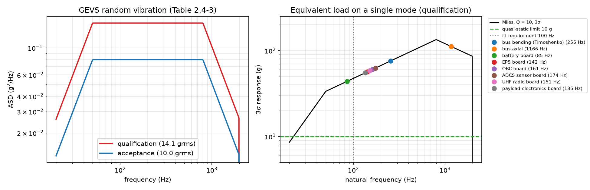
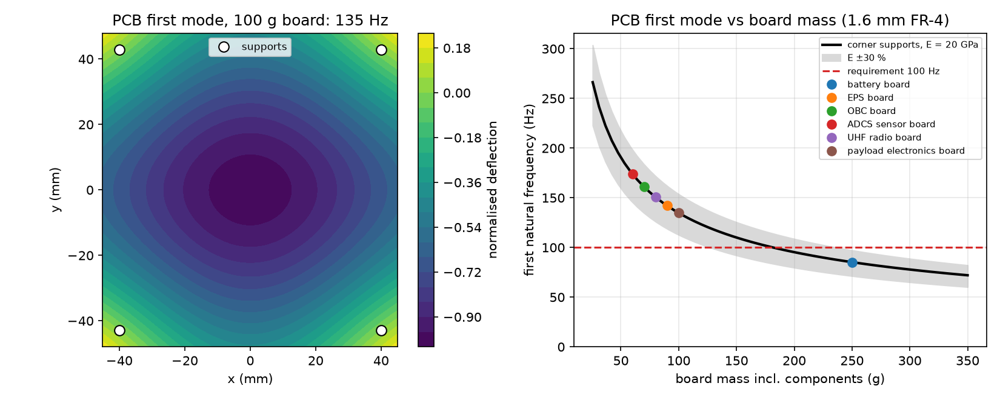

# Project 7: CubeSat structure FEA (SOLIDWORKS Simulation) — in progress

The structural analysis of the 3U CubeSat from [Project 6](../project6_cubesat_adcs/)
(4 kg, 100 × 100 × 340.5 mm): launch loads, natural frequencies and random vibration,
built to the CubeSat Design Specification (CDS Rev 14.1) and NASA GEVS (GSFC-STD-7000B).
Every FEA result is checked against an independent hand calculation.

| Step | Content | Status |
|---|---|---|
| 0 | Licence check + solver benchmark (cantilever bar vs beam theory) | done |
| 1 | Hand calculations: mass budget, 10 g quasi-static, beam/plate frequencies, GEVS + Miles | done |
| 2 | CAD of the structure (rails, frames, end plates, PCB stack, mass dummies) | next |
| 3 | Static FEA, mesh convergence, comparison with step 1 | |
| 4 | Modal analysis + effective mass, cross-check with Python models | |
| 5 | Random vibration (GEVS qualification), margins of safety | |
| 6 | README, figures | |

## Step 0 — licence and solver benchmark

`sw/run.ps1 Step0` compiles `sw/SwSim.cs` + `sw/Step0.cs` (C#, early-bound SOLIDWORKS
interop) and drives SOLIDWORKS 2025 + Simulation headlessly:

- Every study type can be created, including nonlinear and linear dynamic
  (transient / harmonic / **random vibration** / response spectrum), so the licence is
  Simulation Premium.
- Benchmark: 20 × 20 × 200 mm 6061-T6 bar fixed at one end, 10-node tetrahedra.

| Mode | SOLIDWORKS (2 mm mesh) | Euler–Bernoulli | Timoshenko FE (`hand_calcs.py`) |
|---|---|---|---|
| 1st bending | 407.3 Hz | 408.3 Hz | 405.1 Hz |
| 2nd bending | 2441 Hz | 2559 Hz | 2426 Hz |
| torsion | 3556 Hz | 3563 Hz (St-Venant) | — |
| axial | 6341 Hz | 6319 Hz | — |

Effective mass of the first bending pair: 0.612 per direction (theory 0.613); axial
0.807 (theory 8/π² = 0.811).

## Step 1 — hand calculations (`step1_hand_calcs.py`)

Inputs and their sources are in `specs.py`; anything not from a standard is marked
ASSUMPTION. The solvers are first checked against textbook values (free square
plate λ = 13.468, corner-supported λ = 7.11 vs Leissa 7.12; GEVS spectrum integrates to
14.14 / 10.00 grms).

Findings:
- **Mass:** 3.46 kg modelled (structure 20 %); centre of mass +11 mm (CDS limit
  ±70 mm). Inertia 0.038 / 0.038 / 0.006 kg·m², within 8 % of what Project 6 used.
- **Quasi-static 10 g is not critical.** The worst result is buckling of a rail that
  has no intermediate frames (margin +0.9 at 6 kg).
- **Hollow angle rails break CDS 2.2.8.** Their ends offer only 23 mm² against the
  required 6.5 × 6.5 mm, so the rails need solid end feet.
- **Bus first bending mode** (cantilever test-fixture case): 255 Hz with shear
  deformation of the 1 mm walls included, 309 Hz without it; 170 Hz with the rails
  alone. Axial mode: 1166 Hz.
- **PCBs on 4 corner supports set the first mode.** A board heavier than 182 g drops
  below 100 Hz. The 250 g battery board gives 85 Hz, so it needs a centre support or
  a stiffener.
- **Random vibration sizes the structure.** Miles' equation with Q = 10 gives
  44–112 g (3σ), against 10 g quasi-static. Under the 3σ axial load, rails without
  frames fail in buckling (margin −0.80); frames every 1U give +0.78.

Run: `../.venv/Scripts/python.exe step1_hand_calcs.py` (~7 s).
Standards used (PDFs not in the repo): CDS Rev 14.1; GSFC-STD-7000B (GEVS) Tables
2.2-3 and 2.4-3; NASA-STD-5001B Table 1.
